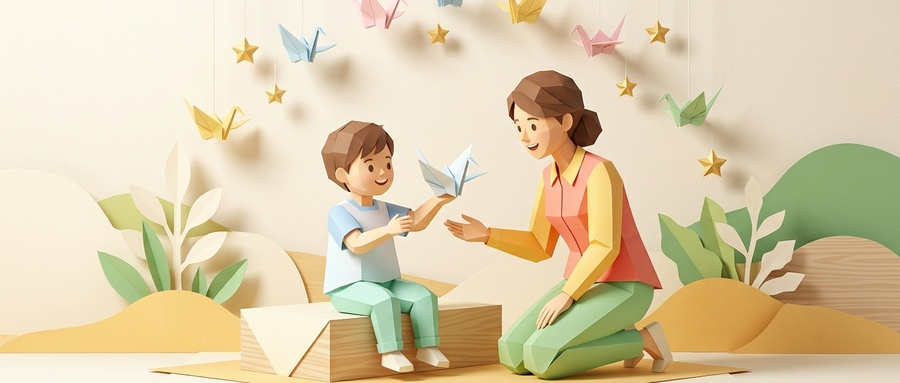

# 为什么越夸“你真聪明”，孩子越害怕失败？哈佛与斯坦福推崇的“成长型夸奖法”，关键就在这3句话
**Why the More You Say "You're So Smart," the More Kids Fear Failure: The 3 Growth-Mindset Phrases Harvard Parents Swear By**

> **【公众号封面图说明（立体折纸艺术风格）】**
> * **标准官方封面（900×383）**：`./images/wechat_cover_growth_mindset_900x383.jpg`（已严格适配微信公众号 2.35:1 首条封面规范，居中聚焦，安全留白）
> * **超清高清封面（1800×766）**：`./images/wechat_cover_growth_mindset_1800x766.jpg`（2倍超清高分屏适配）
> * **视觉意境与艺术隐喻**：现代立体折纸雕塑画风（3D Origami / Papercraft）。折纸本身正是“成长型思维”的最高写照——耐心折叠每一个步骤、不怕压痕重试，最终化平淡纸张为振翅纸鹤。画面中折纸形态的孩子自豪托起折好的纸鹤，身旁的母亲蹲下身平视微笑鼓励，头顶轻盈纸鹤与星辰飞舞，温暖治愈。
> 
> 

---

<blockquote style="background-color: #f0f7ff; border-left: 5px solid #2563eb; padding: 14px 18px; margin: 20px 0; border-radius: 4px; color: #1e293b; line-height: 1.75;">
<strong>导读</strong>：在几乎所有的家庭里，我们都能听到这样的声音：“宝宝把积木拼好了，真聪明！”“口算全对了，太厉害了！”我们以为这是在建立孩子的自信，却不知在心理学实证研究中，<strong>无节制的“聪明”赞美，正在悄悄成为毁掉孩子抗挫力的一剂“慢性毒药”</strong>。今天，让我们用通俗温暖的中英双语，拆解斯坦福著名的拼图实验，并把哈佛大学与积极心理学推崇的“成长型夸奖三句话”带回家。  
<em style="color: #64748b; font-size: 14px;">Editor's Note: In almost every household, we hear praise like: "You solved that puzzle, you're so smart!" or "A hundred on your math test—you're a genius!" We genuinely believe we are building their self-esteem. Yet groundbreaking psychological research reveals that <strong>indiscriminate praise for "intelligence" often becomes a toxic straitjacket that paralyzes children with the fear of failure</strong>. Today, let's explore Stanford's landmark puzzle study and introduce the 3 transformative growth-mindset phrases recommended by Harvard educators.</em>
</blockquote>

---

<h2 style="color: #1e40af; border-left: 6px solid #2563eb; padding-left: 12px; margin: 32px 0 10px 0; font-size: 19px; line-height: 1.4;">01. 斯坦福颠覆性实验：被夸“聪明”的孩子，后来怎么了？</h2>

The Landmark Stanford Study: What Really Happens When We Praise Intelligence?

斯坦福大学著名心理学教授**卡罗尔·德韦克（Carol S. Dweck）**和她的团队，曾进行了一项跟踪数百名五年级小学生的划时代研究。

研究人员让孩子们独立完成一系列中等难度的益智拼图题。几乎所有孩子都顺利完成了。随后，研究人员将孩子们随机分成两组，并给予了**一句完全不同的夸奖**：

* <strong style="color: #b91c1c;">A组（夸天赋与智力）</strong>：*"Wow, you scored very high! You must be so smart at this!"*  
  （“哇，你拿了很高分！你在这方面一定特别聪明！”）
* <strong style="color: #047857;">B组（夸过程与努力）</strong>：*"Wow, you scored very high! You must have worked really hard at this!"*  
  （“哇，你拿了很高分！你刚才一定非常投入、努力！”）

仅仅这**一句话之差**，在接下来的环节中，却引发了令人瞠目结舌的裂变：

<strong style="color: #475569;">【当面临更高难度的挑战时】</strong> 
A组（夸聪明）： 拒绝挑战，选择容易题 ──&gt; 遇到难题焦虑挫败 ──&gt; 成绩暴跌 20% 
B组（夸努力）： 90%主动挑选难题 ──&gt; 视挑战为探险游戏 ──&gt; 成绩提升 30%！

*When offered a choice between a safe, easy puzzle and a challenging new one where they might learn something valuable:*
* **90% of the "effort-praised" children chose the harder challenge.**  
* **The "intelligence-praised" children overwhelmingly retreated to the easy ones.**

为什么会这样？

因为当孩子被贴上“聪明”的标签时，他在潜意识里接收到的是一种**沉重的能力审判**：
> <em style="color: #475569;">“大人们喜欢我是因为我‘聪明’。如果下一次我做不出来、做错了，就意味着我‘变蠢了’。为了维持‘我很聪明’的光环，我必须绝对回避任何可能会暴露我短处的风险。”</em>

而那些被肯定了“努力与过程”的孩子，他们深信能力是流动的肌肉：
> <em style="color: #047857;">“做不出来不是因为我笨，只是因为我还没有掌握更好的方法，多试几次就能攻克它！”</em>

---

<h2 style="color: #9a3412; border-left: 6px solid #ea580c; padding-left: 12px; margin: 32px 0 10px 0; font-size: 19px; line-height: 1.4;">02. 家长最容易踩中的 3 种“剧毒式夸奖”</h2>

The 3 Toxic Praise Habits Most Parents Fall Into

很多父母爱子心切，脱口而出的夸奖往往带有隐性的副作用。快来看看你中招了几个：

<h3 style="color: #c2410c; background-color: #fff7ed; padding: 8px 14px; border-radius: 6px; border-left: 4px solid #f97316; margin: 20px 0 10px 0; font-size: 16px;">① 虚焦式敷衍：“哇，你太棒了！太厉害了！”</h3>
* **英文隐患**：*Empty superlatives ("Good job! You're awesome!")*
* **负面效应**：大而无当的夸奖就像高糖分的棉花糖。孩子其实根本不知道自己究竟“哪一点做得很棒”。久而久之，孩子会对空洞的赞美产生耐受，甚至将其视作大人敷衍应付的背景噪音。

<h3 style="color: #c2410c; background-color: #fff7ed; padding: 8px 14px; border-radius: 6px; border-left: 4px solid #f97316; margin: 20px 0 10px 0; font-size: 16px;">② 天赋绑架：“我们家宝贝就是随爸爸，有数学/音乐天赋”</h3>
* **英文隐患**：*Fixed-trait labeling ("You're a natural born mathematician!")*
* **负面效应**：一旦步入高年级，数学题变得复杂、不再能凭直觉秒杀时，被冠以“有天赋”的孩子往往最先心态瓦解。他们会陷入极端自我怀疑：“原来我没有天赋，我以前都是骗人的。”

<h3 style="color: #c2410c; background-color: #fff7ed; padding: 8px 14px; border-radius: 6px; border-left: 4px solid #f97316; margin: 20px 0 10px 0; font-size: 16px;">③ 唯结果论：“考了双百！妈妈太为你骄傲了！”</h3>
* **英文隐患**：*Conditional love tied strictly to outcomes ("100 points! I'm so proud of you!")*
* **负面效应**：无意间向孩子传递了一条冰冷的等式：**“我的爱是有门槛的——你的分数等于你的受喜爱程度。”**

---

<h2 style="color: #065f46; border-left: 6px solid #10b981; padding-left: 12px; margin: 32px 0 10px 0; font-size: 19px; line-height: 1.4;">03. 哈佛与积极心理学推崇的“成长型夸奖 3 句话”</h2>

The 3 Harvard-Backed Phrases That Build Lifelong Resilience

想要培养一个不怕困难、越挫越勇的高逆商（AQ）孩子，我们只需要在日常对话中，把评价的聚光灯从**“静态的天赋”**转移到**“动态的探索”**上。记住这 3 句魔法句式：

<h3 style="color: #047857; background-color: #ecfdf5; padding: 10px 14px; border-radius: 6px; border-left: 4px solid #10b981; margin: 22px 0 12px 0; font-size: 16.5px;">第一句：肯定“具体策略与细节”（Praise Strategy & Detail）</h3>

❌ <strong>传统夸法</strong>：“这幅画画得真好看，你真有艺术天分！”

✅ <strong>成长型夸法</strong>：<strong>“妈妈注意到你画晚霞时，把紫红和金黄两层颜色慢慢叠在了一起，层次特别丰富。你是怎么琢磨出这个调色办法的？”</strong>

* **Bilingual In Action**:  
  *"I love how you experimented with blending purple and gold for the sunset. It gives the clouds so much depth. How did you come up with that technique?"*
* **背后的心理赋能**：引导孩子复盘自己的**成功策略**。当孩子意识到好结果来源于可沉淀的步骤时，他的能力感是极其踏实且可复制的。

---

<h3 style="color: #047857; background-color: #ecfdf5; padding: 10px 14px; border-radius: 6px; border-left: 4px solid #10b981; margin: 22px 0 12px 0; font-size: 16.5px;">第二句：肯定“专注耐受与面对挫折的韧性”（Praise Resilience & Grit）</h3>

❌ <strong>传统夸法</strong>：“这么快就拼好了？真是个神童！”

✅ <strong>成长型夸法</strong>：<strong>“刚才底座塌了两次，你不但没有发脾气扔掉积木，反而蹲下来仔细数了齿轮的卡扣，耐心地重装了一次。这份不服输的耐心，比积木本身了不起多了！”</strong>

* **Bilingual In Action**:  
  *"That Lego tower collapsed twice, but you didn't throw it in frustration. Instead, you knelt down, checked the interlocking gears, and patiently rebuilt it. That persistence is far more impressive than the tower itself!"*
* **背后的心理赋能**：将“失败”重新定义为**“收集经验与调整参数的过程”**。孩子会明白：犯错不可耻，从错误中汲取养分才是最酷的本领。

---

<h3 style="color: #047857; background-color: #ecfdf5; padding: 10px 14px; border-radius: 6px; border-left: 4px solid #10b981; margin: 22px 0 12px 0; font-size: 16.5px;">第三句：肯定“内在喜悦与自我超越”（Praise Intrinsic Joy & Self-Surpassing）</h3>

❌ <strong>传统夸法</strong>：“得了第一名/考了满分，妈妈太为你脸上有光了！”

✅ <strong>成长型夸法</strong>：<strong>“这道奥数题你一个人在草稿纸上演算了四遍，终于把它攻克了！此时此刻，你心里是不是觉得特别痛快、特别有成就感？”</strong>

* **Bilingual In Action**:  
  *"You worked on this challenging puzzle across four scrap sheets until you cracked it yourself! How does it feel inside your heart right now? Enjoy that thrilling feeling of breakthrough!"*
* **背后的心理赋能**：把“评价自己的裁判权”还给孩子。不要让孩子活在他人的肯定或掌声里，让他真正体会到**克服万难、自我实现后的内在多巴胺激荡**。

---

<h2 style="color: #4338ca; border-left: 6px solid #6366f1; padding-left: 12px; margin: 32px 0 10px 0; font-size: 19px; line-height: 1.4;">04. 极简实操：家庭日常夸奖中英对照备忘录</h2>

Quick Cheat-Sheet for Everyday Parenting Moments

为了方便家长们在生活中随取随用，我们整理了一份日常场景清单：

| 日常场景 | 避免说的“固定型”口头禅 | 建议替换的“成长型”话术（中英对照） |
| :--- | :--- | :--- |
| **做完复杂作业** | “你太聪明了，一看就会！” | **“这道题很有挑战性，但你的解题思路非常清晰，步步有据！”** <em style="color:#64748b;">"This problem was challenging, but your logical steps were exceptionally clear!"</em> |
| **打比赛/考试没发挥好** | “没关系，下次咱们一定拿第一” | **“我们来看看哪几个环节可以改进，每一次失误都是大脑升级的绝佳机会。”** <em style="color:#64748b;">"Let's inspect what we can fine-tune. Every mistake is just your brain expanding its wiring!"</em> |
| **主动收拾玩具/房间** | “真是个乖孩子/懂事的好宝宝” | **“你今天把积木按颜色收回了盒子里，找东西方便多了，非常负责任！”** <em style="color:#64748b;">"You sorted the blocks by color into their bins today. That takes real responsibility!"</em> |
| **坚持阅读/练琴** | “你真有毅力，妈妈给你买玩具奖励” | **“你今天整整专注练了20分钟，听得出后面的节奏越来越稳了，感觉到了吗？”** <em style="color:#64748b;">"You stayed focused for 20 solid minutes. Can you feel how much smoother your rhythm has become?"</em> |

---

<h2 style="color: #7c3aed; border-left: 6px solid #8b5cf6; padding-left: 12px; margin: 32px 0 10px 0; font-size: 19px; line-height: 1.4;">05. 结语：父母最高级的爱，是允许孩子不完美</h2>

Conclusion: The Greatest Gift of Love Is Permission to Be Imperfect

作家纪伯伦在《先知》中曾写道：
> *“你的儿女，其实不是你的儿女。他们是生命对于自身渴望而诞生的孩子。他们借助你来到这世界，却非因你而来。”*

每个孩子来到世上，都自带好奇探索的火种。他们不需要被捧上“天生聪明”的冰冷神坛，因为神坛之下便是万丈深渊；他们真正需要的，是无论飞得多高、跌得多痛，父母都在一旁温暖守望的目光：

“孩子，去尽情探索吧。跌倒了也没关系，我们蹲下身来，拍拍灰尘，看看到底学到了什么，然后笑着再次出发。”

*Children do not need to be crowned on fragile pedestals of "innate intelligence." What they truly need is unconditional emotional ground beneath their feet: "Go explore with all your heart. When you stumble, we will kneel beside you, dust off your knees, celebrate what you've learned, and take the next step together."*
