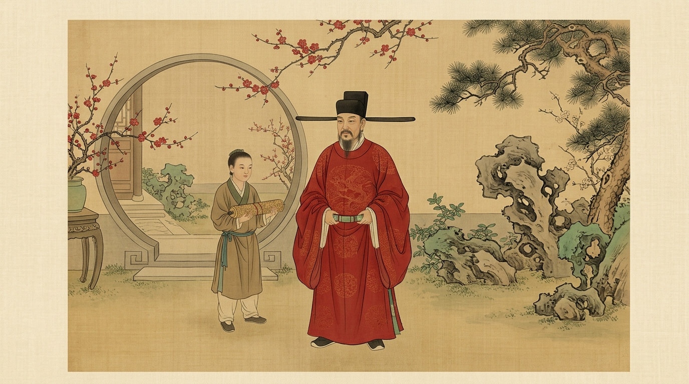
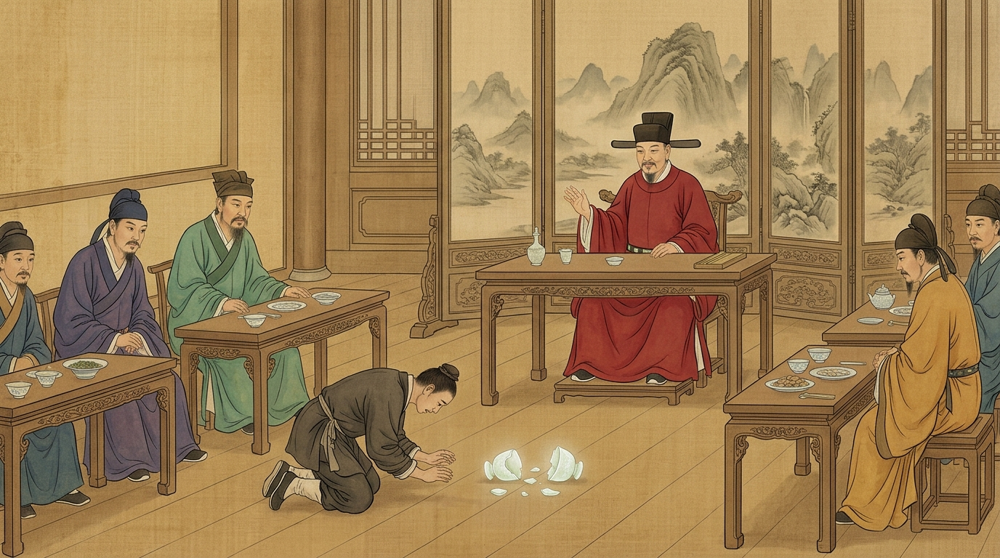
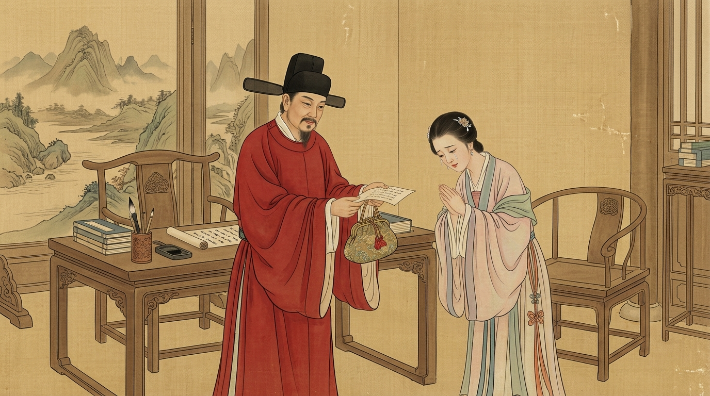

# 侍从失手摔碎稀世玉杯跪地等死，当朝宰相只说了16个字：何为真正的教养？
**The Servant Smashed an Invaluable Jade Cup and Knelt Awaiting Death, the Chancellor Uttered Just 16 Words: What Is True Nobility?**

> **【公众号封面图说明】**
> * 配图文件：`./images/han_qi_wechat_cover.jpg`
> * 画风与规格：传统院体绢本设色工笔画，泛黄古绢肌理，16:9 横幅宽屏，中心主体聚焦，预留充足安全边距，完美兼容微信公众号封面 **2.35:1（900×383）** 自动裁切。
> 
> 

---

> **导读**：一个人的教养，不看他顺风顺水时有多温文尔雅，而看他手握特权、面对弱者犯错时，选择如何反应。北宋名相韩琦一生历仕三朝、封魏国公，被誉为“天下第一流人物”。他留给后世最震撼的人性答卷，不是平定战乱的赫赫战功，而是面对一件粉碎的绝世玉杯、面对一个身陷泥淖的弱女子时，那一抹春风化雨的慈悲与克制。
> 
> *Editor's Note: A person's true cultivation is never revealed by their polite smiles in good times, but by how they treat the vulnerable when wielding absolute power. Chancellor Han Qi of the Northern Song Dynasty, Duke of Wei, was celebrated as "the premier statesman of the empire." Yet his greatest legacy was not merely his statecraft, but his boundless grace—when an irreplaceable jade treasure was shattered, and when a destitute maiden stood before him at the mercy of fate.*

---

## 01. 碎玉不怒：16字化解滔天雷霆
**Shattered Jade, Unshaken Grace: 16 Words that Calmed a Storm**

北宋仁宗年间，一代名臣韩琦出任定州统帅。当时有一位富商为了巴结讨好他，特意献上了一对罕见的**白玉盏**。

这对玉杯通体晶莹剔透、毫无瑕疵，杯壁薄如蝉翼，对着光能照出人影，堪称世所罕见的国宝级无价之宝。韩琦十分喜爱，每次军政大宴款待贵宾时，都会吩咐侍从小心取出，一人面前摆上一只以示敬意。

*During the reign of Emperor Renzong of the Northern Song Dynasty, the esteemed statesman Han Qi served as the military commander of Dingzhou. A wealthy merchant, seeking to curry favor, presented him with an exquisite pair of **white jade cups**.*

*The cups were utterly flawless, translucent as moonlight, and paper-thin—a pair of peerless imperial treasures. Han Qi cherished them dearly and brought them out only during grand banquets to honor his most distinguished guests.*

有一日，韩琦再次大宴幕僚与宾客。酒过三巡，正当大家觥筹交错、极尽欢畅之时，一名年轻的小吏端着果盘退后，脚下一个踉跄，不偏不倚撞翻了摆放白玉盏的几案！

只听“当啷”两声清脆刺耳的巨响，那对稀世白玉盏从案上跌落，狠狠砸在坚硬的地砖上，瞬间粉身碎骨，化为满地狼藉的碎玉渣！

*One evening, Han Qi hosted another grand banquet. Mid-revelry, a young attendant carrying a tray stumbled backward, accidentally colliding with the low table holding the white jade cups!*

*With two piercing crashes, the priceless treasures plunged onto the stone floor, shattering into dozens of sharp, irrecoverable fragments!*

刹那间，喧闹的宴会厅死一般寂静。乐师停了演奏，宾客面面相觑，连大气都不敢喘一声。在宋代，军中纲纪森严，帅府重器被毁，这等过失足以让小吏人头落地！

那名闯下大祸的小吏早已吓得魂飞魄散、面如死灰。他扑通一声跪倒在地，浑身抖若筛糠，拼命叩头，额头上鲜血直流，绝望地等待着主帅的雷霆之怒与斩首军令。

*The hall froze in terrified silence. Music halted; guests stared wide-eyed, scarcely daring to breathe. Under the iron discipline of a Song Dynasty military command, destroying an heirloom could easily cost the servant his life.*

*The young clerk turned as pale as ash. Falling to his knees, trembling uncontrollably, he kowtowed furiously until his forehead bled, awaiting the commander's fury and death sentence.*

然而，主座之上的韩琦神色丝毫未变。他既没有拍案而起，也没有流露半分懊恼。

只见他缓缓端起茶盏，微微一笑，转头对着满堂惊魂未定的宾客，平静地说了十六个字：

> **“大凡物之成毁，有时数存焉。彼因失手，何罪之有？”**  
> （天地间万物的长久与破灭，冥冥中自有定数。他不过是一时失足失手，又不是故意的，何罪之有呢？）

*Yet from the head of the table, Han Qi did not flinch. He showed neither fury nor sorrow.*

*Setting down his teacup with a faint, serene smile, he looked around at the trembling room and spoke sixteen unforgettable words:*

> *"All things in heaven and earth have their allotted time of existence and demise. He stumbled by pure accident—not by intent. What crime has he committed?"*

说罢，韩琦命人温和地将小吏扶起，迅速收拾干净残局，吩咐换上普通瓷杯继续斟酒上菜。席间韩琦谈笑自若、举杯痛饮，仿佛刚才摔碎的只是一枚瓦罐。

**因为在他心里：一件器物哪怕再价值连城，也终究只是死物；而一条活生生的性命与一个普通人的尊严，才重逾千斤。**

*Han Qi instructed attendants to help the terrified youth to his feet, sweep away the shards, and replace them with regular porcelain cups. Throughout the rest of the night, Han Qi laughed, drank, and conversed with his guests as if nothing of consequence had occurred.*

***For in his heart, no earthly treasure—no matter how rare—could ever outweigh the life, soul, and dignity of a fellow human being.***

---

## 02. 还妾赠金：至高权力下的克制与慈悲
**Redeeming the Maiden: Restraint and Mercy at the Pinnacle of Power**

如果说“碎玉不怒”彰显的是一个人的**气度与格局**，那么韩琦晚年的另一桩真实轶事，则体现了上位者登峰造极的**克制与慈悲**。

韩琦官居相位、名震天下之时，家仆曾花费重金，在市场上为他买下一位容貌绝美的小妾侍奉起居。

当女子被领进韩府内堂拜见时，韩琦却发现女子虽然生得倾国倾城，神情却悲苦欲绝，跪在地上泪如泉涌。

*If overlooking the shattered cups demonstrated Han Qi's **magnanimity**, another historical episode in his later years proved his supreme **moral restraint and nobility**.*

*While serving as Prime Minister, his household staff purchased a remarkably beautiful young woman to serve as his concubine.*

*When she was brought into the inner hall, Han Qi noticed that beneath her breathtaking beauty lay profound grief; she fell to her knees, weeping inconsolably.*

换做一般的富贵豪强，既然银货两讫、签了身契，女子便是私有财产，谁会在意她的眼泪？但韩琦却心中不忍，温和地请她起身，柔声询问缘由。

女子抽泣着道出实情：她原本并非风尘贱民，而是一位朝廷武官之女。父亲生前获罪被贬、客死异乡，官府催逼巨额债务，母亲走投无路、老幼无以度日，万般无奈之下，才将她卖身为妾，换来银两替父清偿官债。

*An ordinary nobleman, having paid the silver and held the purchase deed, would have treated her as mere property, indifferent to her tears. But Han Qi's heart was stirred by compassion. He helped her up and gently inquired into her sorrow.*

*The girl wept as she revealed the truth: She was the daughter of a deceased imperial military officer who had fallen into heavy official debt. With the court demanding repayment and her widowed mother destitute, she had sacrificed herself to clear her father's name and save her starving family.*

听罢这番悲剧，韩琦肃然起敬。他长叹一声，深感朝廷武官死后遗属凄惨，更敬佩眼前女子舍身救母的至孝大义。

当夜，韩琦严守男女大防，**当即与女子分房而居，不仅未曾近她分毫，甚至连她的衣角都未曾触碰。**

第二天清晨，韩琦让人取来她的卖身契，当着女子的面一把火烧成灰烬；随后，他又自掏私房腰包，派心腹差役带足银两赶赴她家乡，**替其全家还清了所有官府债务**。

不仅如此，韩琦还拿出了一笔极其丰厚白银装进匣子，郑重交给女子作为嫁妆，并托可靠长辈为她在士庶良善之家寻得一门体面的亲事，以正妻之礼将她风光嫁出。

*Hearing her tragic tale, Han Qi sighed with deep reverence for her filial devotion.*

*That night, upholding strict moral boundaries, **he lodged her in an honored guest pavilion, never touching a hair on her head.***

*At dawn, Han Qi summoned the servants, retrieved her purchase deed, and burned it to ashes before her eyes. He then dipped into his own savings, sending trusted stewards to her hometown to **pay off her family's government debt in full**.*

*Moreover, he gifted her a generous chest of silver as a wedding dowry and arranged a respectable marriage with a virtuous young man, ensuring she was wed with the honor and dignity of a lawful wife.*

在拥有绝对处置权、唾手可得的时候，选择放下欲望、体察他人的无助，这才是深深刻在骨子里的君子之德。

*To possess absolute authority over a person, yet choose restraint, empathy, and elevation—this was the truest manifestation of a Song Dynasty gentleman's soul.*

---

## 03. 结语：顶级教养，是不向弱者借优越感
**Epilogue: True Nobility Never Borrows Superiority from the Weak**

荀子曾说：“君子宽容而不傲，温良而不欺。”

纵观千古风云，为什么韩琦的名字能够历经千年依然受万人敬仰？

因为世俗之中，多的是“在强者面前卑躬屈膝，在弱者面前作威作福”的伪善之辈；多的是“得理不饶人，借由过错肆意践踏他人自尊”的傲慢看客。

*The ancient philosopher Xunzi wrote: "A noble gentleman is magnanimous without pride, and benevolent without deceit."*

*Why has Han Qi's name shone across a millennium of history?*

*Because this world is crowded with people who grovel before the powerful yet bully the weak; people who, finding themselves in the right, mercilessly crush another's dignity over a minor accident.*

韩琦用他的一生证明了：
1. **器物有价，而人心无价**：能容人过错，不是因为财物不珍贵，而是因为他明白“物为人役，而非人为物役”；
2. **最高级的风骨，是不难为人**：手握生杀大权时，不把权力当成宣泄恶意的借口；处在俯视位置时，依然能弯下腰，给身处绝境的灵魂留一把体面的伞。

*Han Qi proved through his life:*  
*1. **Treasure Has a Price; Dignity Is Priceless:** Forgiving an error does not mean wealth is cheap, but that "objects exist to serve people, not people to serve objects."*  
*2. **The Noblest Strength Is Never Putting Others on the Spot:** When holding absolute authority, never use it to indulge cruelty; when looking down from the heights of power, bend down to offer an umbrella of respect to those in the rain.*

**所谓真正的教养，不是名牌华服，也不是满腹经纶；而是你身处高位时，从来不需要从弱者的恐惧中去借优越感。**

*True nobility is neither expensive silk nor encyclopedic eloquence; it is the grace to stand at the summit of life, yet never seek validation from the fear of the vulnerable.*

---

> 💡 **今日互动话题 / Readers' Corner**  
> 无论是“碎玉不怒”的豁达，还是“还妾赠金”的纯正，韩琦的哪一个细节最击中你的内心？在日常生活中，你见过最体现一个人教养的瞬间是什么？欢迎在评论区分享您的见解与故事！

