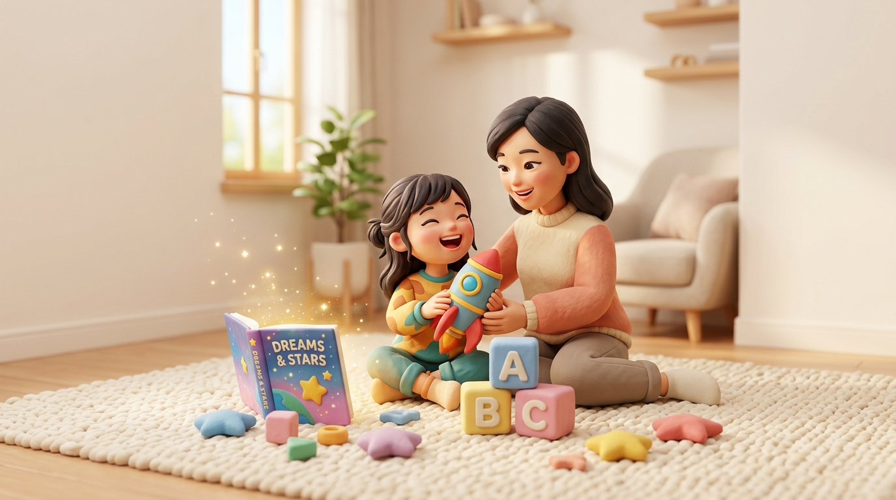
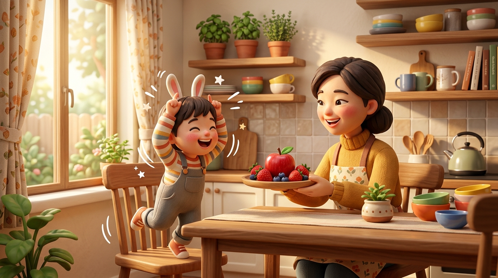

# 别把英语当成“一门课”，把它变成孩子的“新玩具”！
**Stop Treating English as a "Class"—Make It Your Child's New Toy!**

> **【公众号封面图说明】**
> * 建议配图：`./images/wechat_cover_english_toy.jpg`
> * 适配比例：标准 16:9 居中构图，完美兼容微信公众号封面 2.35:1（900×383）自动裁切区域，两侧主体清晰不穿帮。
> 
> 

---

### 导读 / Introduction

很多家长问：“孩子 5、6 岁，背单词总是记了又忘，一提学英语就坐不住，怎么办？”

其实，孩子天生就是语言天才。他们不需要枯燥的单词表，也不需要死记硬背的语法。今天这篇文章，想用最简单温和的中英双语，和爸爸妈妈们分享：**如何不靠死记硬背，让英语在每天的吃喝玩乐中自然“长”出来。**

*Many parents ask: "My child is 5 or 6 years old. They forget vocabulary right after memorizing, and they can't sit still for English lessons. What should I do?"*

*In fact, children are born language geniuses. They don't need boring word lists or grammar drills. Today, in gentle bilingual words, let's explore: **How to let English grow naturally through everyday fun and love—without rote memorization.***

---

## 01. 为什么孩子不喜欢“背单词”？
**Why Do Kids Hate Memorizing Words?**

想象一下，如果有人指着一张冰冷的卡片逼你念十遍“Apple（苹果）”，你也会觉得索然无味。

但是，如果正在厨房剥水果的妈妈回过头，递给孩子一个红彤彤、香气扑鼻的苹果，微笑着说：

> **"Here is a juicy red apple! Let's take a big bite—Crunch!"**  
> （给你一个多汁的红苹果！咱们咬一大口——咔嚓！）

伴随清脆的声音和舌尖的清甜，“Apple”瞬间就有了味道、声音和温度。

*Imagine someone pointing at a cold flashcard and forcing you to repeat "Apple" ten times. You would be bored, too!*

*But what if Mom, peeling fruit in the kitchen, turns around with a warm smile and hands over a sweet, crunchy apple:*

> *"Here is a juicy red apple! Let's take a big bite—Crunch!"*

*With that crisp sound and sweet taste, the word "Apple" instantly gains flavor, sound, and emotional warmth.*

> **💡 启蒙秘诀 / The Core Secret：**  
> 对学龄前孩子来说，**语言不是用来“背”的，而是用来“玩”和“做事”的。**  
> *For young children, language is not something to memorize; it is a lively tool to play, touch, and explore.*

---

## 02. 三招让英语在家里“活”起来
**3 Easy Ways to Bring English to Life at Home**

不需要家长有一口地道的伦敦腔，也不需要买昂贵的网课，只要在家里做好这三件小事：

### 第一招：边做动作边说（TPR 全身反应法）
**Tip 1: Say It While Moving (Total Physical Response)**

5、6 岁孩子的思维与身体是连在一起的。用身体动作作为记忆支架，孩子学得最快、记得最牢：

* 🐰 **蹦蹦跳跳 / Hop & Jump:**  
  *"Jump high like a little rabbit!"* （像可爱的小兔子一样跳高高！）
* 🛑 **定格游戏 / Freeze:**  
  *"One, two, three, freeze! Don't move!"* （一、二、三，木头人定住！不许动哦！）
* 🤗 **大熊抱 / Bear Hug:**  
  *"Give me a warm bear hug!"* （给妈妈/爸爸一个大大的熊抱！）

---

### 第二招：把日常小事变成“寻宝游戏”
**Tip 2: Turn Daily Routines into a Fun Treasure Hunt**

在家里、超市、公园里，把英语变成捉迷藏与探险：

* **找颜色 / Spot the Colors:**  
  *"Can you find something yellow in the kitchen?"* （能在厨房里找到黄色的东西吗？）  
  *"Look! A yellow banana!"* （看！一根香蕉！）
* **数一数 / Count Together:**  
  *"Let's wash our hands! Count with me: One, two, three... All clean!"* （咱们洗洗手！跟我一起数：一、二、三……干干净净啦！）

---

### 第三招：多用“具体鼓励”，保护开口的自豪感
**Tip 3: Praise Their Courage, Not Just Perfection**

当孩子勇敢蹦出一个英文词，哪怕发音不太准、语法不完整，也**千万不要立刻打断纠错**。先给孩子一个热烈的击掌：

* 👏 *"High five! I love how clear and loud your voice was!"*  
  （击个掌！我太喜欢你刚才那洪亮又自信的声音了！）
* 🌟 *"You tried a brand new word today! You are so brave!"*  
  （你今天尝试了一个全新的词汇！太勇敢啦！）

---

## 03. 今日亲子高频短句（建议家长收藏）
**Pocket Phrases for Today (Save & Try Tonight!)**

今晚不妨从这 5 句充满爱意的高频生活短句开始，和宝贝在日常温情中对话：

| 生活场景 (Daily Scene) | 地道亲子英语 (Natural English) | 温暖中文解释 (Chinese) |
| :--- | :--- | :--- |
| **🌅 晨起唤醒** | **"Rise and shine, my little sleepyhead!"** | 太阳晒屁股啦，我的小懒虫起床喽！ |
| **🧼 饭前洗手** | **"Let's wash away the tiny germs together!"** | 咱们一起把手上的小细菌冲跑吧！ |
| **🍓 分享美食** | **"One for you, and one for me!"** | 这个给你，这个给我，我们一起吃！ |
| **🧸 收拾玩具** | **"Time to tuck the toys in for bed!"** | 该送玩具小熊回小箱子里睡觉啦！ |
| **🌙 睡前晚安** | **"Sweet dreams! Love you to the moon and back."** | 做个好梦！爸爸妈妈超级超级爱你。 |

---

## 写在最后 / Words from the Heart

儿童语言启蒙就像在花盆里播下一颗小种子。

不必焦虑它今天怎么还没发芽、明天怎么还不开花。只要每天给它一点点阳光（开心的亲子游戏）、一点点雨露（温暖真诚的鼓励），总有一天，这颗种子会在爱的土壤中拔节生长。

孩子会发现：**原来英语不是考卷上的冷冰冰题目，而是通往奇妙世界的一扇彩色大门。**

*Language learning is like planting a tiny seed.*

*Don't worry if it hasn't bloomed today. Just give it daily sunshine (happy play) and gentle rain (loving praise). One day, you will be amazed to see that **English is not a cold test paper, but a vibrant, colorful door opened to a wider world.***

---

> 💬 **今日互动话题 / Tonight's Sweet Challenge**  
> 今晚睡觉前，试着抱着宝贝温柔地说一句：  
> **"Sweet dreams! Give me a big bear hug!"**  
> 看看宝贝会给你什么惊喜又萌趣的反应吧！欢迎在评论区分享你的亲子故事～
