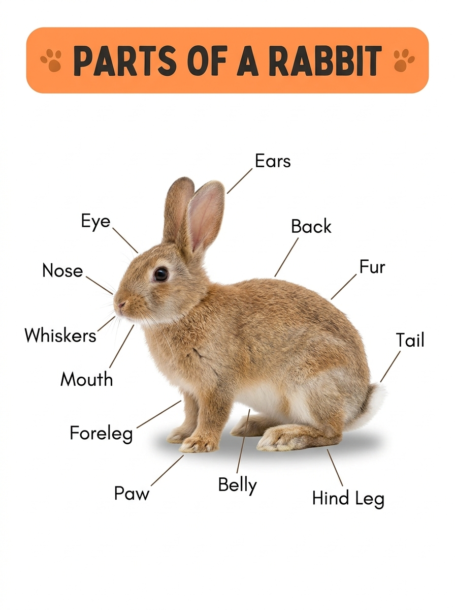
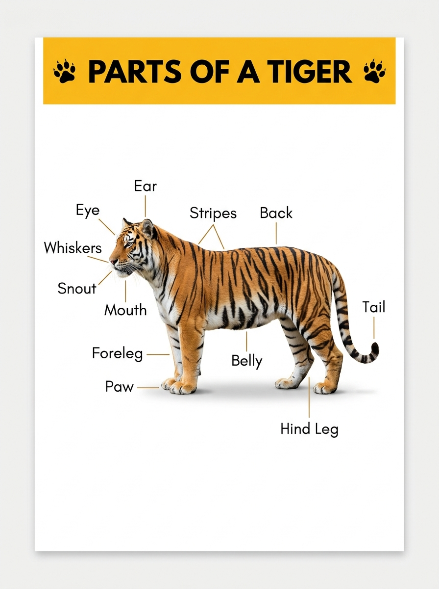
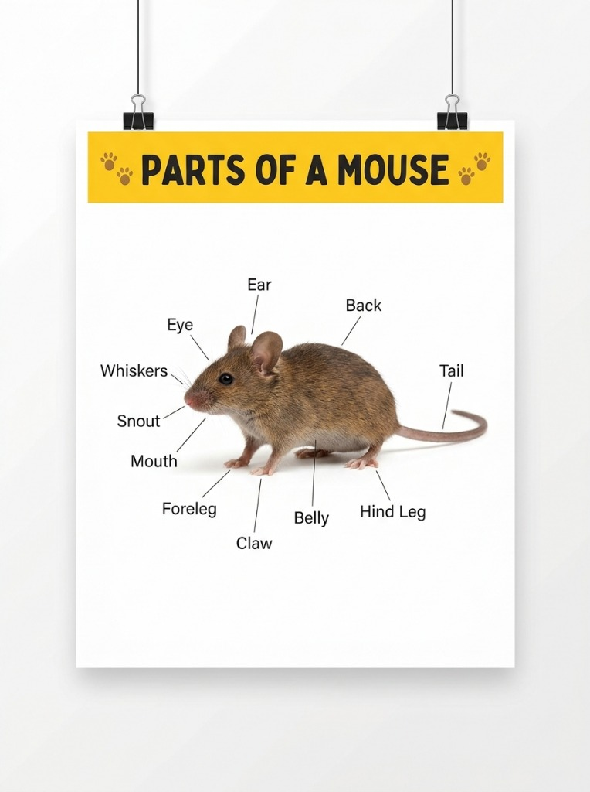

# 别小看兔子的耳朵、老虎的尾巴！这些动物身体部位藏着惊人“超能力”
**Don't Underestimate a Rabbit's Ears or a Tiger's Tail: The Amazing Superpowers Hidden in Animal Bodies**

> **【公众号封面图说明】**
> * 配图文件：`./images/wechat_cover_animal_superpowers.jpg`
> * 构图规格：标准 16:9 横版宽屏，中心主体聚焦，预留充足安全边距，完美兼容微信公众号封面 **2.35:1（900×383）** 自动裁切。
> 
> 

---

> **导读**：小孩子天生就是动物迷。他们常常指着绘本问：“妈妈，为什么兔子的耳朵这么长？为什么老虎身上有一道道黑色条纹？为什么小老鼠的尾巴光秃秃的？”
> 其实，在大自然的演化工坊里，**动物身体的每一个部位，都是历经千万年精心打磨的“生存高科技”**！今天这篇文章，带你和孩子一起揭秘兔子、老虎和小老鼠身上令人惊叹的身体“超能力”，顺便用图解把这些高频英文词汇一次性装进小脑瓜！
> 
> *Editor's Note: Children are natural animal lovers. They often ask: "Mom, why are bunny ears so long? Why does a tiger have bold black stripes? Why is a mouse's tail so long and hairless?"*
> *In truth, in nature's grand workshop, **every single body part is a piece of high-tech survival engineering refined over millions of years**! Today, let's explore the astonishing "superpowers" hidden inside rabbits, tigers, and mice—and pick up practical bilingual vocabulary along the way!*

---

## 01. 兔子篇：长耳朵可不只是用来“听声音”的！
**The Rabbit: Long Ears Are Way More Than Just Microphones!**

每次看到软萌的小兔子，孩子们最先注意到的就是它那两只竖得高高的大耳朵（**Ears**）。但你可能不知道，兔子的耳朵藏着两个极其逆天的秘密武器：

*Whenever children see a fluffy bunny, the first thing they notice is those long, upright **Ears**. But did you know a rabbit's ears actually possess two incredible secret weapons?*

### 🚀 超能力一：360度独立旋转“生物雷达”
**Superpower 1: 360-Degree Independent Radar**
人类的耳朵长在脑袋两侧无法转动，但兔子的两只长耳朵，**每一只都可以独立旋转达 270 度**！一只朝前探听草丛里的风吹草动，另一只可以同时朝后警惕天上的猛禽。这种双通道监听雷达，让兔子在吃草时也能全方位锁定天敌的声音。

*While human ears are stationary, a rabbit can **rotate each ear up to 270 degrees independently**! One ear can scan forward for rustling grass, while the other simultaneously monitors the sky for predatory birds.*

### ❄️ 超能力二：奔跑中的“天然车载空调”
**Superpower 2: The Biological Radiator**
兔子浑身裹着厚厚的毛皮（**Fur**），而且没有汗腺，在烈日下奔跑极易中暑。它的长耳朵内侧布满了密密麻麻的细微血管网。天热时，血管迅速扩张，微风一吹，血液里的热量便被大量带走，给全身降温；天冷时，血管收缩紧贴后背，瞬间保暖！

*Rabbits are covered in thick **Fur** and cannot sweat. Their large ears are packed with an intricate network of tiny blood vessels. When it's hot, the vessels expand to release excess body heat into the breeze; when it's chilly, they contract to conserve warmth!*

> **📌 兔子高频部位词汇 / Rabbit Vocabulary**：  
> • **Ears**（长耳朵） • **Whiskers**（探路胡须） • **Snout / Nose**（抽动的小鼻子）  
> • **Hind Leg**（弹跳力惊人的强壮后腿） • **Fluffy Tail**（毛茸茸的短尾巴）

---

## 02. 老虎篇：百兽之王的条纹与尾巴，是致命武器！
**The Tiger: Stripes and Tail Are Secret Weapons!**

如果说兔子是逃生大师，那威风凛凛的老虎就是丛林里的顶级战术大师。老虎身上那标志性的黑黄条纹（**Stripes**）和粗壮的尾巴（**Tail**），可不是为了好看！

*If the rabbit is a master of escape, the magnificent tiger is the jungle's ultimate tactical genius. Its iconic black **Stripes** and muscular **Tail** are far more than just wild fashion!*

### 🌿 超能力一：专骗色盲的“终极隐身衣”
**Superpower 1: The Optical Illusion Invisibility Cloak**
很多人觉得老虎的亮橙色毛皮在绿树丛中太显眼了，怎么能捕猎呢？其实，老虎的主要猎物（如鹿、野猪）是**红绿色盲**！在鹿的眼睛里，红橙色的老虎看起来就是一片柔和的绿色。当黑色的垂直条纹与林间摇曳的竹影、树影融为一体，猎物走到几米远都根本看不出前面蹲着一只大老虎！  
更神奇的是：**哪怕把老虎的毛全部剃光，它下层的皮肤上依然长着一模一样的黑条纹！**

*Humans see orange against green foliage easily, but a tiger's primary prey (like deer and wild boar) are **red-green colorblind**! To a deer, an orange tiger appears as a pale green shadow blending seamlessly with tall grass and bamboo stalks. Even more astonishing: **if you shaved a tiger bald, its skin still bears the exact same striped pattern!***

### 🏎️ 超能力二：时速60公里的“高速平衡舵”
**Superpower 2: The High-Speed Balancing Rudder**
老虎在茂密丛林中高速追击猎物时，时速可达 60 公里以上。面对猎物的突然蛇形急转弯，老虎那条长达一米多的粗壮长尾（**Tail**），就像赛车尾部的扰流板和巨型方向舵，通过向反方向甩动来抵消巨大离心力，让沉重的身躯在急速拐弯时稳如泰山、绝不打滑翻车！

*When charging through dense forests at 60 km/h, prey frequently make abrupt zig-zag turns. A tiger's heavy, muscular **Tail** acts as a dynamic counterweight—swinging in the opposite direction to prevent tipping over during violent high-speed turns!*

> **📌 老虎高频部位词汇 / Tiger Vocabulary**：  
> • **Stripes**（独一无二的虎纹指纹） • **Paws & Claws**（带消音肉垫的锋利虎爪）  
> • **Amber Eyes**（夜视能力是人类6倍的眼睛） • **Muscular Tail**（高速平衡舵长尾）

---

## 03. 老鼠篇：看似弱小，却长着精密“传感雷达”！
**The Mouse: Tiny Body, Giant Sensory Marvel!**

童话里的小老鼠总是东躲西藏，但在现实世界里，它那长长的胡须（**Whiskers**）和光秃秃的长尾巴（**Tail**），是动物界最灵敏的物理仪器之一。

*Though mice seem small and timid, their delicate **Whiskers** and long **Tail** are among nature's most sophisticated scientific instruments.*

### 📏 超能力一：自带卡尺的“胡须夜视雷达”
**Superpower 1: Whiskers That Act as Night Calipers**
老鼠几乎是个高度近视眼，但它在伸手不见五指的漆黑管道或地洞里却能风驰电掣。全靠它嘴唇两侧长长的胡须（**Whiskers**）！这可不是普通的毛发，胡须根部布满了密集的感觉神经末梢。老鼠往前一钻，只要胡须两端触碰不到障碍物，它就知道：**“这个洞口足够宽，我的身体肯定能钻过去！”**

*Mice have notoriously poor eyesight, yet they dart through pitch-black tunnels without bumping into walls. Their long **Whiskers** are packed with thousands of sensory nerve endings. If the whiskers clear a gap without bending, the mouse instantly knows: **"The opening is wide enough for my body to squeeze through!"***

### 🎪 超能力二：走钢丝与跳伞的“微型平衡杆”
**Superpower 2: The Tightrope Walker's Balancing Pole**
老鼠光秃秃的长尾巴（**Tail**）不仅能像杂技演员手中的平衡杆一样，帮助它在极细的电线和绳索上奔跑如飞；更神奇的是，如果不慎从几米高处跌落，长尾巴会在空中像螺旋桨一样飞速旋转，帮助身体在半空中瞬间扭转朝向，确保永远是**四爪肉垫（Paws）稳稳着地**！

*A mouse's hairless tail acts just like a circus tightrope walker's balancing pole, allowing it to sprint across high-tension wires. If dropped from high up, the tail whips through the air to orient the body, guaranteeing a soft landing on all four **Paws**!*

> **📌 老鼠高频部位词汇 / Mouse Vocabulary**：  
> • **Whiskers**（敏锐的测距胡须） • **Snout**（灵敏的嗅觉吻部）  
> • **Claws**（攀爬抓地利爪） • **Flexible Tail**（高空平衡长尾）

---

## 04. 亲子双语大复习：动物身体部位卡片
**Bilingual Summary: Animal Body Parts Flashcard**

读完了有趣的故事，不妨和孩子一起比一比这三种动物的身体部位，把这些生活英语牢牢记在心里吧：

| 身体部位 (Body Part) | 英文发音与拼写 | 隐藏的惊人超能力 (Hidden Superpower) |
| :--- | :--- | :--- |
| **耳朵** | **Ears** `/ɪəz/` | 兔子的长耳朵可 270° 独立旋转，天热还能当散热空调！ |
| **胡须** | **Whiskers** `/ˈwɪskəz/` | 老鼠的胡须是精密量尺，测量洞口宽窄绝不卡头！ |
| **条纹** | **Stripes** `/straɪps/` | 老虎的隐身迷彩服，猎物眼里的绿色伪装，剃光毛皮肤依然带纹！ |
| **尾巴** | **Tail** `/teɪl/` | 老虎急转弯的防翻车方向舵；老鼠高空跳伞的平衡降落伞！ |
| **爪子** | **Paws & Claws** `/pɔːz & klɔːz/` | 猫科动物自带柔软消音肉垫，走起路来悄无声息！ |
| **后腿** | **Hind Legs** `/haɪnd leɡz/` | 兔子强大的蓄能弹簧，一蹦能跳出身体长度的数倍远！ |

---

## 写在最后 / Final Thoughts

大自然是最好的老师。

每一个看似奇怪的动物部位，背后都凝结着生命的智慧与进化的奇迹。下一次带孩子观察小动物时，不妨蹲下来，和他一起看一看兔子的长耳朵、数一数老虎的大花纹。

当科学探索与双语认知在充满童趣的对话中交融，**孩子学到的不仅是几个英文单词，更是一双懂得观察世界、热爱生命的大眼睛。**

*Nature is the greatest classroom.*

*Every curious animal feature reflects millions of years of evolutionary wonder. The next time you observe animals with your child, pause to marvel at how a bunny moves its ears or how a tiger glides through shadow.*

*When scientific curiosity meets language learning, **children gain far more than vocabulary—they gain eyes that observe the world with wonder and hearts that revere life.***

---

> 💡 **今日互动小挑战 / Daily Family Challenge**  
> 您家宝贝最喜欢哪种动物？今天不妨问问他：“你知道为什么兔子的耳朵这么长吗？”看看小家伙会给你什么天马行空的萌趣答案！欢迎在评论区留言分享～
