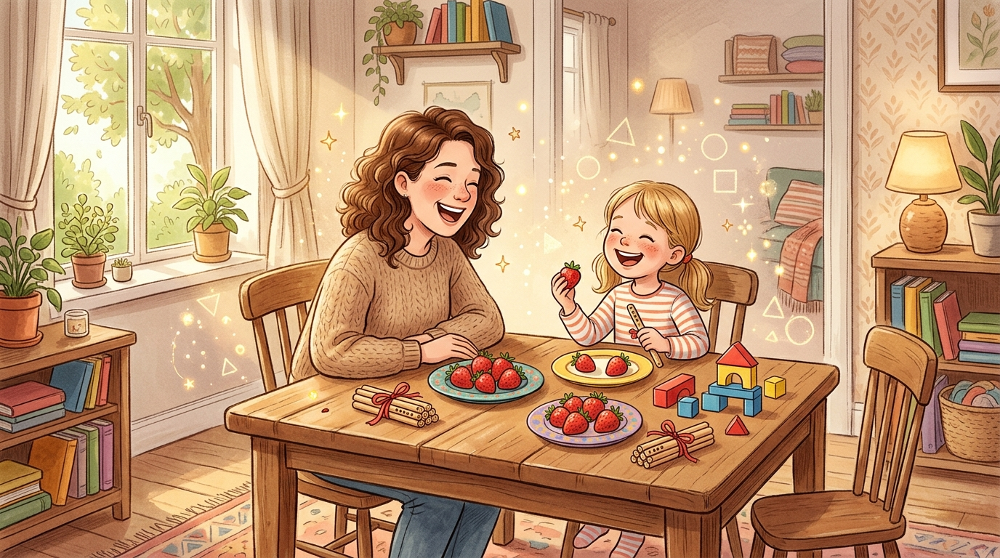
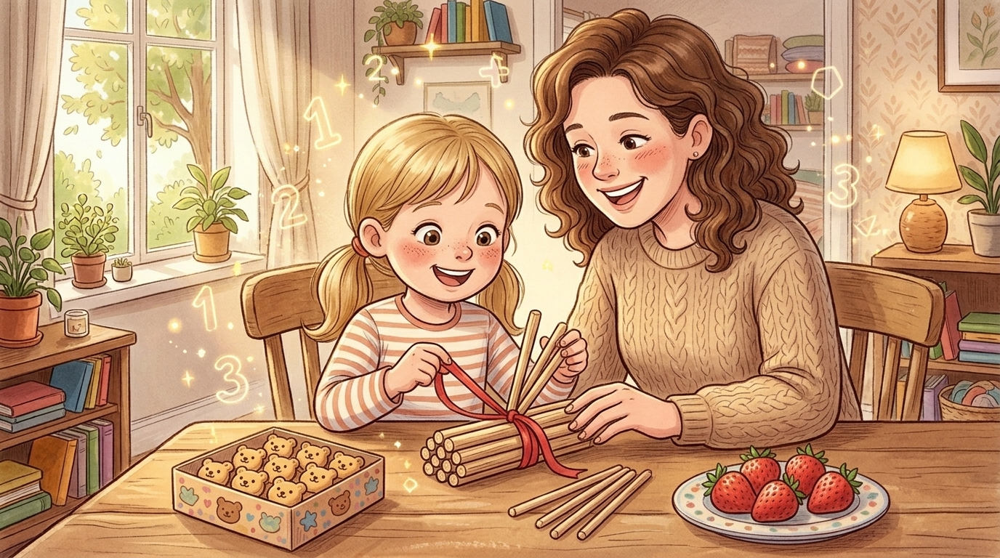
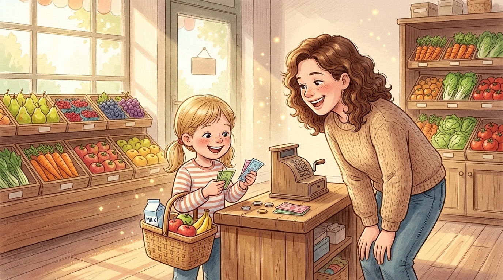

# 周末别再陪孩子死刷题了！逛一次超市、分一盘水果，才是最高级的数学启蒙
**Stop Drilling Worksheets This Weekend! A Trip to the Supermarket and a Plate of Fruit Are the Ultimate Math Lessons**

> **【公众号封面图说明】**
> * 配图文件：`./images/weekend_math_wechat_cover.jpg`
> * 画风与规格：温馨治愈的现代儿童绘本插画风，16:9 横幅宽屏，中心人物聚焦并预留充足安全边距，完美兼容微信公众号封面 **2.35:1（900×383）** 自动裁切。
> 
> 

---

> **导读**：一到周末，很多家长就开始发愁：要不要让五六岁的孩子多刷两页口算题？为什么一道简单的“退位减法”，讲了十遍孩子还是掰着手指头算错？其实，对 5～7 岁的孩子来说，**过早用冰冷的符号逼迫他们死记硬背，只会熄灭探索的火苗**。今天这篇文章，用通俗温暖的中英双语，带您在周末的果盘与超市里，开启一场让孩子眼睛发光的“生活数学探险”。
> 
> *Editor's Note: As the weekend arrives, many parents wonder: Should I make my 5- or 6-year-old finish two more pages of math drills? Why do they still count on their fingers and get regrouping subtraction wrong after ten explanations? In truth, for children aged 5 to 7, **forcing abstract symbols too early only extinguishes their natural curiosity**. Today, in warm bilingual insights, let's turn your weekend fruit plate and grocery trip into an exciting "real-life math adventure."*

---

## 01. 为什么孩子害怕口算纸，却喜欢分草莓？
**Why Do Kids Dread Math Worksheets, Yet Love Sharing Strawberries?**

儿童发展心理学家皮亚杰曾指出：5～7 岁的孩子正处于**“具象思维阶段”**。

如果你在纸上写下冷冰冰的 `7 - 3 = ?`，孩子的大脑里是一片空白的，他只能靠机械背诵或焦虑地掰手指；但如果你端来一盘刚洗好的红草莓，笑着对他说：

> **"Look! There are 7 juicy strawberries on the plate. Let's eat 3 of them together—yum! How many are left now?"**  
> （看！盘子里有 7 颗多汁的红草莓，咱们一起吃掉 3 颗——真甜呀！现在数数盘子里还剩几颗？）

*Developmental psychologist Jean Piaget noted that children aged 5 to 7 live in the stage of **concrete thinking**.*

*If you write a cold equation like `7 - 3 = ?` on paper, a child's mind goes blank, relying on rote memory or anxious finger-counting. But what if you bring out a plate of fresh red strawberries and say with a smile:*

> *"Look! There are 7 juicy strawberries on the plate. Let's eat 3 of them together—yum! How many are left now?"*

当孩子亲口吃掉 3 颗，再伸出小手点着盘子里的草莓数出“1, 2, 3, 4”时，他的眼神里会闪烁着笃定的光芒。这就是享誉全球的**新加坡 CPA 教学法（Concrete 具象实物 $\rightarrow$ Pictorial 形象图形 $\rightarrow$ Abstract 抽象符号）**的核心精髓：**先让孩子用眼睛看见、用小手摸到，数学才会从枯燥的任务变成好玩的魔法。**

*When your child eats three strawberries and counts the remaining four with their own fingers, their eyes light up with certainty. This is the heart of the world-renowned **Singapore CPA Approach (Concrete $\rightarrow$ Pictorial $\rightarrow$ Abstract)**: **Let children see it with their eyes and touch it with their hands first, and math transforms from a chore into pure magic.***

---

## 02. 周末餐桌游戏：“小棒拆捆”攻克退位减法大魔王
**Weekend Table Game: "Unbundling Sticks" to Conquer Subtraction**

很多大班和一年级孩子最怕的“拦路虎”，就是 **100 以内的退位减法**（比如 `32 - 8` 或 `52 - 28`）。为什么个位不够减要向十位借 1？为什么借了 1 之后可以用“尾加补数”？

这个周末，不妨在餐桌上准备几盒 **10 块装的小饼干**，或者几捆用红皮筋扎起来的 **10 根装小木棒（或吸管）**，带孩子玩一次“拆捆游戏”：

*The biggest hurdle for many young learners is **subtraction with regrouping** (such as `32 - 8` or `52 - 28`). Why do we borrow 1 from the tens place? And how does the "complement number" work?*

*This weekend, prepare a few boxes of **10-pack cookies** or bundles of **10 counting sticks tied with rubber bands**, and play the "Unbundling Game" at the dining table:*

1. **摆出题目 / Set the Stage (`32 - 8`)**：
   在桌上放 **3 捆**（每捆 10 根）小木棒，旁边再放 **2 根**散棒。
   问孩子：*"We have 2 loose sticks here, and we need to take away 8. Is that enough?"*（个位只有 2 根散棒，要拿走 8 根，够拿吗？）
2. **亲手拆捆 / Untie the Bundle**：
   孩子摇摇头说“不够！”这时，让孩子**亲手解开其中 1 捆小棒的红丝带**，“哗啦”一声散成 10 根单棒！
   *"Let's untie one bundle of ten! Take away 8 sticks from this 10—how many are left in your hand?"*（咱们拆开一捆十！从这 10 根里直接拿走 8 根，看看手里还剩几根？）
3. **发现“补数”的秘密 / Discover the Complement**：
   孩子一眼就能看出：`10 - 8 = 2`，手里还剩 **2 根**！
   再引导孩子把这剩下的 **2 根（就是 8 的“好朋友补数”）**，和盘子里原本的 **2 根**合在一起：`2 + 2 = 4`！而十位因为被拆走了 1 捆，还剩 `3 - 1 = 2` 捆，答案就是 **24**！

*1. **Set the Stage (`32 - 8`):** Place 3 bundles of ten sticks and 2 loose sticks on the table. Ask: "We only have 2 loose sticks, and we need to take away 8. Is that enough?"*  
*2. **Untie the Bundle:** Let your child **physically untie one bundle of 10** into loose sticks! "Take away 8 directly from this 10—how many are left?"*  
*3. **Discover the Complement:** Your child immediately sees that `10 - 8 = 2`! Then, merge those remaining **2 sticks (the complement of 8)** with the original **2 loose sticks**: `2 + 2 = 4`! And since one bundle was untied from the tens, `3 - 1 = 2` bundles remain—making **24**!*

> **🌟 教育顿悟时刻 / The "Aha!" Moment：**  
> 当孩子亲手拆过三次小棒，他就永远不会再死记硬背口诀，因为他的脑海里已经刻下了清晰的物理画面：**“个位不够减，拆一捆十拿走减数，剩下的补数加上原来的尾巴！”**  
> *Once a child physically unties the bundle three times, they no longer need rote memorization. A vivid mental picture is formed: **"Unbundle a ten, take away the number, and add the remaining complement to the ones!"***

---

## 03. 周末超市探险：让孩子当一回“小小收银员”
**Weekend Supermarket Adventure: Let Your Child Be the "Little Cashier"**

除了家里的果盘，周末带孩子逛超市、菜市场，更是绝佳的“实景数学游乐场”。

不要让孩子只是坐在购物车里刷手机，给他一张 **20 元纸币** 和一个小购物篮，任命他为今天的 **“家庭首席采购官（Chief Family Shopper）”**！

*Beyond the dining table, a weekend trip to the supermarket is the ultimate real-world math playground.*

*Instead of letting your child sit passively in the cart, hand them a **20-yuan bill** and a small basket, appointing them today's **"Chief Family Shopper"***!

在超市里，你可以和孩子玩这三个超级有趣的双语寻宝任务：

* **任务一：比大小寻宝（Price Detective）**  
  *"Look at these two boxes of milk. One is 12 yuan, and the other is 15 yuan. Which one is cheaper, and by how much?"*  
  （看看这两盒牛奶，一盒 12 元，一盒 15 元。哪一盒更便宜？便宜了多少钱呢？）
* **任务二：凑十法大挑战（Make-Ten Challenge）**  
  *"We bought 6 apples. If we want a full bag of 10 apples, how many more do we need to pick?"*  
  （我们已经挑了 6 个苹果，如果想凑够满满一袋 10 个，还需要再拿几个？）
* **任务三：收银台找零钱（Cashier Change Game）**  
  *"Our bananas cost 13 yuan. If we pay with a 20-yuan bill, how much change will we get back?"*  
  （香蕉一共 13 元，如果我们付一张 20 元纸币，收银员阿姨会找给我们几块钱呢？）

当孩子自己算出找回 7 元钱，并从收银员手中接过硬币和纸币的那一刻，他体会到的是**“原来数学这么有用！我能帮爸爸妈妈算账了！”**——这种源自真实生活的**胜任感与自豪感（Sense of Competence）**，比做对一百道口算题都管用。

*When your child calculates the 7-yuan change on their own and receives the coins from the cashier, they experience a powerful realization: **"Math is actually useful! I can help Mom and Dad manage money!"** This real-world sense of competence fuels intrinsic motivation far better than a hundred worksheets ever could.*

---

## 04. 周末亲子数学双语口袋卡（建议收藏）
**Weekend Math Bilingual Pocket Card (Save & Practice!)**

这个周末，不妨把下面这 **5 句高频亲子数学互动短句** 用起来，既练了数感，又磨了耳朵：

| 周末生活场景 (Scene) | 地道亲子英语 (Natural English) | 温暖中文互动 (Chinese) |
| :--- | :--- | :--- |
| **1. 餐前摆碗筷** | **We have 4 people today. How many chopsticks do we need in total?** | 今天家里有 4 个人吃饭，咱们一共需要拿几根筷子呀？ |
| **2. 盘子分水果** | **Let's share these 10 grapes equally—half for you, half for me!** | 咱们把这 10 颗葡萄平分吧——你一半，我一半！ |
| **3. 电梯看楼层** | **We are on Floor 3, and we're going to Floor 11. How many floors up?** | 我们现在在 3 楼，要去 11 楼，电梯还要往上爬几层呢？ |
| **4. 拆捆算减法** | **Let's untie one bundle of ten to help the ones place!** | 咱们拆开一捆“10”，去帮帮个位上的小数字吧！ |
| **5. 夸奖好脑筋** | **Wow, you figured it out with your own hands! You're a little math wizard!** | 哇，你用自己的小手算出来啦！你真是个数学小魔法师！ |

---

## 写在最后 / Final Thoughts

对于五六岁的孩子来说，**“慢即是快（Slow is Fast）”**。

不要急着用满页的算式去催熟一颗刚发芽的种子。趁着周末阳光正好，带孩子去菜市场闻一闻果蔬的清香，在餐桌上拆一拆小棒、分一分草莓。

当数学在热气腾腾的日常生活里“活”过来，你会发现：**那个曾经一提算术就皱眉头的小家伙，早已在欢声笑语中，爱上了思考本身。**

*For young children, **slow is fast**.*

*Do not rush to force an unripe seed with pages of cold drills. Enjoy the weekend sunshine—take your child to the market, count the fruits, and unbundle sticks at the kitchen table.*

*When math comes alive in the warmth of everyday life, you will find that your little one hasn't just learned how to calculate—they have fallen in love with thinking itself.*

---

> 💡 **周末打卡小挑战 / Weekend Family Challenge**  
> 这个周末，试着和宝贝玩一次**“分水果”**或**“超市找零钱”**的游戏吧！您家宝贝目前在算术启蒙中最喜欢玩什么小游戏？欢迎在评论区留言分享您的育儿妙招～
