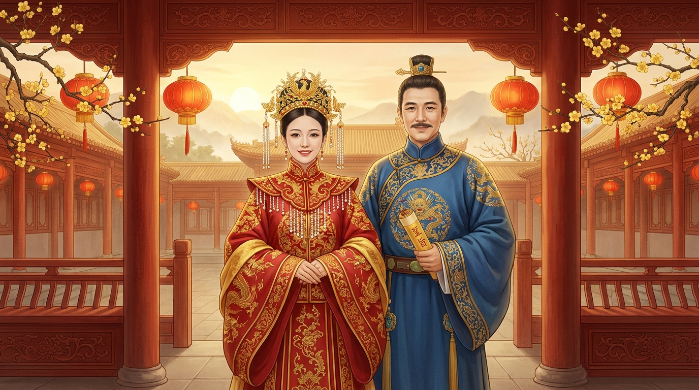
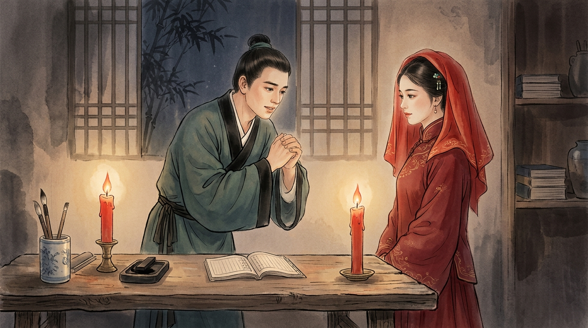
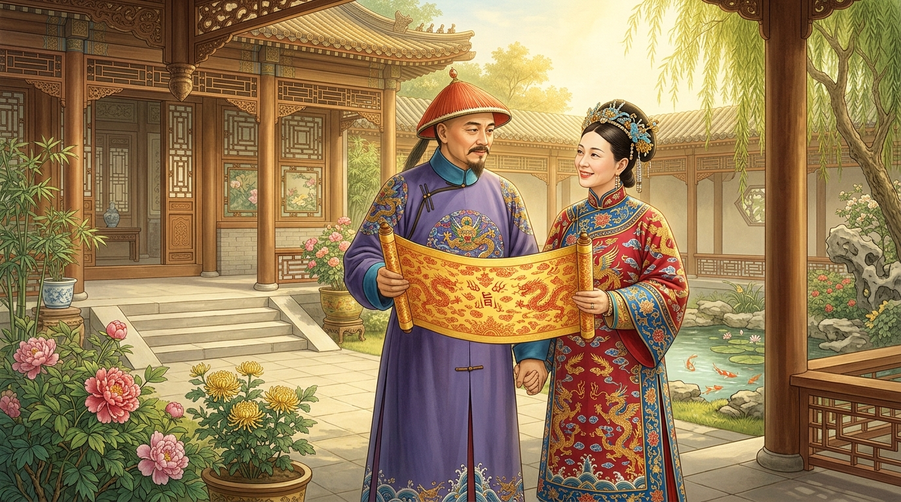

# 大小姐嫌他穷悔婚，小丫鬟挺身替嫁：三十年后，她受封一品诰命夫人
**The Heiress Spurned Him for His Poverty, the Maid Stepped In: Thirty Years Later, She Was Crowned a First-Rank Imperial Lady**

> **【公众号封面图说明】**
> * 配图文件：`./images/tao_shu_wechat_cover.jpg`
> * 构图规格：标准 16:9 横幅工笔重彩画卷，人物居中并预留充足安全边距，完美适配微信公众号封面 **2.35:1（900×383）** 自动裁切区域。
> 
> 

---

> **导读**：嫌贫爱富，似乎是世俗场里最常见的戏码；但命运最公平的地方在于，它总会在岁月深处，给每一份善良与远见标上意想不到的厚赏。清代名臣陶澍与替嫁丫鬟的一生传奇告诉我们：**一个女人最高级的智慧，是识人于微时；一个男人最顶级的风骨，是不负糟糠之恩。**
> 
> *Editor's Note: Despising the poor and favoring the rich is an age-old worldly cliché. Yet fate has a way of rewarding genuine kindness and foresight across the decades. The true historical legend of Qing Dynasty statesman Tao Shu and the humble maid who married him in place of her wealthy mistress proves a timeless truth: **A woman's highest wisdom lies in recognizing character in times of obscurity; a man's noblest integrity lies in honoring the one who stood by him in poverty.***

---

## 01. 寒门书生迎亲日，富家千金毁约时
**A Poor Scholar's Wedding Day, A Rich Heiress's Betrayal**

清朝嘉庆年间，湖南安化有一位名叫陶澍的青年书生。陶澍自幼聪颖过人、满腹经纶，但无奈家道中落，父亲早逝，家里穷得连日常温饱都常常捉襟见肘，只剩几间遮风挡雨的茅草旧屋。

早些年，陶家光景尚可时，陶父曾为陶澍与当地富户黄家的千金定下了娃娃亲。然而世态炎凉，眼看迎亲的吉日将近，黄家见陶澍一贫如洗、科举未中，便动了悔婚的心思。

*During the Jiaqing era of the Qing Dynasty, a young scholar named Tao Shu lived in Anhua, Hunan. Brilliant and well-read from childhood, Tao Shu was nonetheless plunged into deep poverty after his father's early passing, left with little more than a dilapidated thatched cottage.*

*Years earlier, when the Tao family was still comfortable, his father had arranged a marriage contract with the daughter of the wealthy Huang family. Yet as the wedding day approached, seeing Tao Shu's penniless state, the Huang family grew regretful and sought to break the promise.*

更有甚者，当地另一个有权有势的吴姓富豪上门提亲，黄家小姐一心想嫁入豪门享清福，在大婚前夕哭闹不止，死活不肯踏进陶家的迎亲花轿。

门外，陶家的迎亲队伍已经吹吹打打到了门口；门内，黄小姐摔碎茶盏、寻死觅活。倘若当场退婚，黄家不仅要背上“嫌贫爱富、背信弃义”的骂名，更无法向乡里宗族交代。黄员外急得在厅堂里团团转，不知如何收场。

*To make matters worse, a wealthy local landowner surnamed Wu came to propose. Eager for a life of luxury, Miss Huang threw a fierce tantrum on the eve of the wedding, refusing to set foot inside Tao Shu's bridal sedan.*

*Outside, Tao Shu's modest wedding procession had already arrived with drums and flutes; inside, Miss Huang smashed teacups and threatened to end her life. Breaking off the marriage on the spot would ruin the Huang family's reputation for treachery and greed. Master Huang paced the hall in utter despair.*

---

## 02. 丫鬟仗义登花轿，寒窑红烛定终身
**A Maid's Noble Sacrifice, A Lifelong Vow by Red Candlelight**

就在黄家上下焦头烂额之际，一直伺候在黄小姐身旁的贴身丫鬟站了出来。

这位姑娘虽出身贫苦，却生得端庄清秀、心地纯良。平日里，她曾几次见过上门拜访的陶澍，深知这位年轻人虽然衣衫朴素，却谈吐不凡、目光清正，绝非池中之物。

她走到黄员外面前，平静而坚定地福了一礼：“老爷，陶公子是重情重义的读书人，咱们黄家不能坏了名声。既然小姐死活不肯嫁，奴婢愿替小姐戴上红盖头，嫁入陶家，全了这桩婚约！”

*Just as the household fell into panic, Miss Huang's personal maid stepped forward.*

*Though born into poverty, the young maid possessed a quiet grace and a pure heart. Having glimpsed Tao Shu on his previous visits, she recognized that beneath his plain cloth robes stood a man of upright character, noble bearing, and extraordinary promise.*

*She bowed calmly before Master Huang and spoke with firm resolve: "Master, Young Master Tao is an honorable scholar, and our household must not be disgraced by breaking faith. Since the Young Mistress refuses to go, I am willing to put on the bridal veil and marry into the Tao family in her place!"*

黄员外如蒙大赦，当即认丫鬟为义女，匆匆为她换上嫁衣，送上了花轿。

当晚，在陶家简陋的寒窑书房里，两支红烛静静燃烧。陶澍挑开红盖头，惊讶地发现眼前的新娘并非黄家大小姐。新娘没有隐瞒，坦诚地跪地将前因后果一五一十道出，并柔声说道：“公子若觉受辱，奴婢甘愿在府中做牛做马伺候公子读书，绝不敢奢求正妻名分。”

*Relieved beyond measure, Master Huang immediately adopted the maid as his foster daughter, dressed her in bridal red, and sent her off in the sedan chair.*

*That night, in Tao Shu's humble cottage study, two red candles flickered warmly. Lifting the veil, Tao Shu was astonished to find a stranger instead of Miss Huang. Without a word of deception, the bride knelt and recounted the entire truth: "Sir, if you feel deceived, I am content to serve you as a maid while you study, and dare not ask for the title of a wife."*

听完这番话，陶澍非但没有半分恼怒，反而心中涌起一股深深的敬意。

他双手将姑娘扶起，郑重地揖了一礼：“黄家小姐弃我，是嫌我今日贫寒；姑娘明知我家徒四壁，却肯仗义相嫁，此乃千金难买的知遇之恩！我陶澍今日对烛起誓，你便是我明媒正娶的唯一结发妻子，此生定不相负！”

*Hearing her words, Tao Shu felt not a trace of anger, but overwhelming respect and gratitude.*

*He gently helped her to her feet and bowed deeply: "Miss Huang spurned me because of my poverty today; yet knowing I have nothing but bare walls, you stepped forward with righteousness and courage. Such grace is more precious than gold! Before these wedding candles, I swear that you are my one and only lawful wife. Never in this life shall I fail you!"*

---

## 03. 三十年风雨同舟，一朝受封“一品诰命”
**Thirty Years Through Wind and Rain, Crowned in First-Rank Glory**

成婚之后，这位替嫁的新娘展现出了极强的持家韧性。

白天，她挑水劈柴、纺线织布，将粗茶淡饭操持得井井有条，从不让陶澍为生计分心；深夜，陶澍在油灯下苦读经史，她便静静坐在一旁缝补衣裳、添油磨墨，用最温柔的陪伴撑起了寒门书生的青云之志。

*After their marriage, the young wife proved to be the pillar of the home.*

*By day, she fetched water, chopped firewood, and wove cloth to keep food on the table, shielding Tao Shu from worldly worries. By night, as Tao Shu pored over classics under a dim oil lamp, she sat quietly beside him mending clothes and grinding ink, fueling his lofty ambitions with unyielding tenderness.*

天道酬勤。嘉庆七年（1802年），陶澍一举考中进士，选入翰林院！

此后三十年间，陶澍在宦海一路披荆斩棘，先后历任山西、四川、安徽、江苏巡抚，最终官至**两江总督、太子少保**，统辖江苏、安徽、江西三省军政大权，成为道光皇帝最为倚重的晚清社稷重臣。

*Heaven rewards the diligent. In 1802, Tao Shu passed the highest imperial examination, entering the prestigious Hanlin Academy!*

*Over the next thirty years, Tao Shu rose steadily through the imperial ranks, serving as Governor of Shanxi, Sichuan, Anhui, and Jiangsu, before ultimately being appointed **Viceroy of Liangjiang and Guardian of the Heir Apparent**—governing three of the empire's wealthiest provinces as a pillar of the Qing court.*

身居极品高位、权倾江南的陶澍，面对无数达官显贵的巴结与送女纳妾，始终恪守当年寒窑红烛下的誓言，一生与妻子相敬如宾。他更是亲自上表朝廷，为妻子请封最高等级的皇室荣耀——**“一品诰命夫人”**！

当明黄色的圣旨与凤冠霞帔送到总督府庭院时，这对相伴三十载的夫妻并肩而立，在满院梅花与阳光下相视一笑，成就了晚清官场最令人艳羡的一段佳话。

*Even at the pinnacle of power and wealth, surrounded by flatterers offering young concubines, Tao Shu remained true to the vow he made by candle-light in his thatched hut. Furthermore, he petitioned the Emperor to bestow upon his wife the highest imperial honor for a woman—**First-Rank Imperial Lady (Yipin Gaoming Furen)**!*

*When the golden imperial edict and phoenix coronet arrived at the Viceroy's residence, the couple of thirty years stood side by side under the sunlit courtyard blossoms, sharing a smile that transcended decades of hardship.*

而当年那个嫌贫爱富、哭闹退婚的黄家大小姐呢？

她在替嫁风波后，如愿嫁给了当地的吴姓富商。谁知那富商之子是个吃喝嫖赌的纨绔子弟，不过十余年便败光了万贯家财。后来黄家与吴家相继衰败，昔日不可一世的黄大小姐晚年流落街头，困顿潦倒。

听说旧事的陶澍夫妇非但没有落井下石，反而托人暗中送去白银百两，助她安度残年。当黄小姐得知当年替自己上花轿的小丫鬟如今已是一品诰命夫人时，捧着银两老泪纵横，悔断肝肠。

*And what became of Miss Huang, who had spurned Tao Shu for his poverty?*

*Shortly after breaking the engagement, she married into the wealthy Wu family as she wished. Tragically, her husband turned out to be a reckless prodigal who squandered the family fortune on gambling and debauchery within a decade. Reduced to destitution in her later years, the once-haughty heiress was left wandering in misery.*

*Upon hearing of her plight, Tao Shu and his wife bore no malice; instead, they quietly sent her a hundred taels of silver to sustain her remaining years. Learning that the humble maid who took her place was now a First-Rank Imperial Lady, Miss Huang wept bitterly in endless regret.*

---

## 04. 结语：命运的馈赠，偏爱清醒与善良的人
**Epilogue: Fate's Greatest Gifts Belong to the Kind and Clear-Eyed**

为什么一个出身低微的小丫鬟，能逆天改命，走上人生巅峰？

很多人以为她只是“运气好、押对了宝”，但细读历史才明白：**这世上从来没有凭空掉下来的福气，所有的逆袭，都是人品与格局的变现。**

*Why could a lowly maid defy fate and ascend to the very peak of honor?*

*Many assume she simply "got lucky." Yet history reveals a deeper truth: **Good fortune never falls from the sky; every extraordinary turnaround is the dividend of one's character and vision.***

1. **她的“眼界”，在于不以一时穷达论英雄**：
   世人皆看重眼前的金银田产，唯独她看重一个少年身上的骨气、学识与人品。莫欺少年穷，是最高级的识人智慧。
2. **她的“善良”，在于危难时刻的担当**：
   她替嫁并非为了攀龙附凤，而是为了帮主家化解危局、保全一个寒门书生的尊严。正因为初心纯粹，才换来了陶澍倾尽一生的敬重。
3. **陶澍的“贵气”，在于富贵不忘糟糠**：
   见过太多“一朝飞黄腾达便休妻弃友”的凉薄故事，陶澍身居总督高位却始终敬妻如初。真正顶级的男人，从不用权势放纵欲望，而是用权势去荣耀那个陪自己走过泥泞的人。

*1. **Her Vision—Looking Beyond Temporary Poverty:** While others saw only empty pockets, she saw the integrity, scholarship, and backbone of a promising youth.*  
*2. **Her Kindness—Stepping Up in Crisis:** She entered the sedan chair not out of greed, but out of loyalty to her household and empathy for an honest scholar.*  
*3. **Tao Shu's Nobility—Honoring the Wife of His Youth:** In a world where powerful men often forgot those who suffered with them, Tao Shu used his supreme status not for self-indulgence, but to crown the woman who walked with him through the mud.*

**人生路上，财物会散尽，皮囊会老去；唯有一颗善良仗义的心，和一份看透浮华的清醒，能陪你穿越大半生风雨，迎来满树繁花。**

*Along the journey of life, wealth may vanish and beauty may fade; only a righteous, compassionate heart and the wisdom to see beyond superficial vanity can carry you through the storms of life into a courtyard full of blossoms.*

---

> 💡 **今日互动话题 / Readers' Corner**  
> 有人说“小丫鬟赢在眼界”，也有人说“她赢在善良与厚道”。读完这段真实历史传奇，您觉得决定一个人一生福报最核心的品质是什么？欢迎在评论区留言交流！
