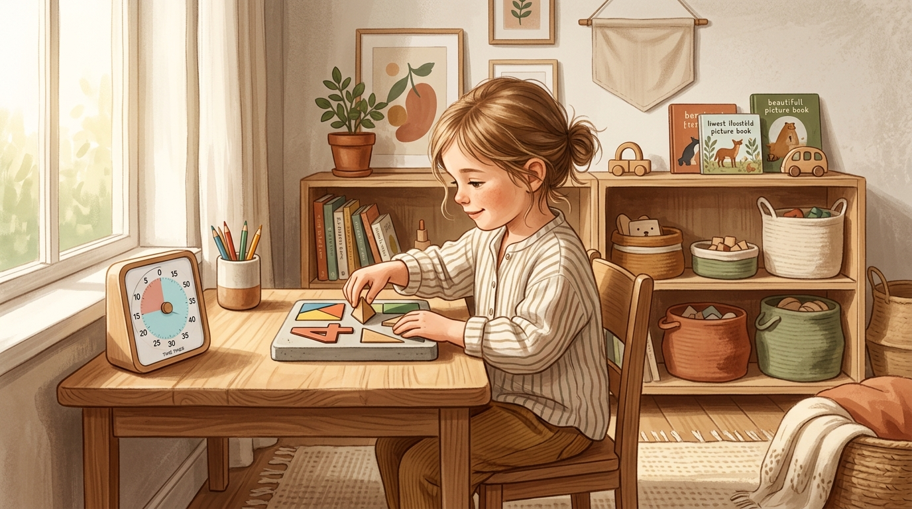
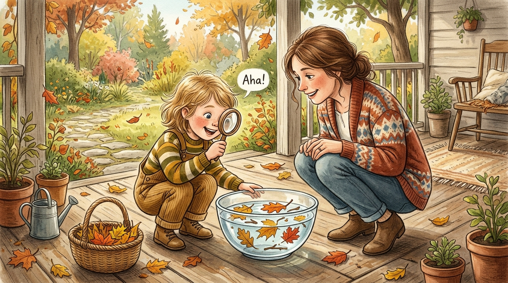

# 从“要我学”到“我要学”：脑科学视角下5~6岁儿童自主学习动机的建构机制与破局路径

> **导语**：在幼小衔接阶段，无数家庭陷入了“不催不动、一催就炸、大人心力交瘁、孩子抵触厌学”的内耗死循环。面对即将升入小学的5~6岁儿童，我们究竟该如何顺应其大脑神经发育的节律，科学点燃孩子内心深处的自驱力开关？本文基于认知神经科学与发展心理学的前沿成果，深度解构儿童自主学习动机的建构密码，并提供一套可落地、可操作的家庭实践方案。

---

## 一、 现象与困境：为什么“越催越慢、越盯越累”？

许多家长在孩子5岁半左右，开始不自觉地开启“小学备战模式”：报满幼小衔接班、每天打卡几页生字和百以内加减法。然而随之而来的，往往是孩子无休止的磨蹭、走神、咬铅笔，甚至哭闹抗拒。

*图1：低认知负荷、具备具象教具与时间可视化的家庭学习角，是保护儿童前额叶专注力的物理基石*

要解开这个死结，我们必须首先撕掉给孩子贴上的“懒惰”、“多动”或“不听话”的标签，站在**神经解剖学**的真实基线上重新审视5~6岁儿童：

1. **前额叶皮层的“发育时差”**：
   5岁半儿童的大脑容积已达成年期的约 $90\%$，神经系统正处于大规模的突触修剪与髓鞘化进程中。然而，负责工作记忆、抗干扰和冲动抑制的脑内最高指挥中枢——**前额叶皮层（Prefrontal Cortex）**，此刻才刚刚开启加速成熟期。
2. **注意力的生理局限**：
   该阶段儿童正艰难地从外在刺激主导的“无意注意”，向依靠意志努力维持的“有意注意”过渡。受制于自上而下的抑制通路尚不健全，在缺乏物理动作互动的纯纸笔形式下，**5岁儿童的平均有效专注时长仅为 12 至 15 分钟**。
3. **身体具象思维的决定性地位**：
   皮亚杰发展阶段表明，学龄前晚期正处于前运算向具体运算过渡的区间。儿童的逻辑思维深植于具体的身体感官动作（抚摸、摆弄、堆叠、空间旋转）之中，大脑尚无法凭空展开纯符号式的抽象运算。

> **核心洞察**：超前推行小学化的长时间端坐静听与机械重复刷题，本质上是在向一个神经回路尚未成熟的器官强行索取超额负荷。这种违背生理基线的过度索取，会迅速压抑前额叶的主动探究机能，给孩子种下长期的学业焦虑。

---

## 二、 动力学底层：解码“我要学”的脑科学三大开关

究竟是什么力量，能够促使一个孩子在没有大人监督的情况下，自发地沉浸在探索之中？现代认知心理学与计算神经科学给出了三大支柱：

### 1. 自我决定理论（SDT）：三大基本心理需求
心理学家德西（Deci）与瑞安（Ryan）指出，内在动机的维系取决于三项基本心理营养：
* **自主感（Autonomy）**：孩子必须体验到自己是“行为的决策者”，而非外在力量驱使的棋子。
* **胜任感（Competence）**：在适度挑战中体验到“我能行”，积累掌控环境的效能感。
* **归属感（Relatedness）**：无论表现如何，都能感知到父母无条件的接纳与情感安全，大脑杏仁核保持平静，前额叶智力资源方能全力运转。

### 2. 计算神经科学的“85%黄金法则”
2019年维尔逊（Wilson）等学者发表在《自然·通讯》上的计算模型揭示：在知觉与分类学习中，**当任务的平均正确率维持在约 $85\%$、试错率维持在约 $15\%$ 时，突触可塑性与神经参数更新速率达到理论峰值**。
* **100% 成功**：大脑多巴胺奖赏预测误差为零，神经回路不再重塑，孩子迅速感到枯燥乏味；
* **错误率达到 50%**：认知过载引发杏仁核应激警报，诱发防御性退缩与自我怀疑；
* **85% 成功 + 15% 可控试错**：既能通过“小胜连胜”稳固胜任感，又能依靠微小悬念激发生物神经突触对未知的求知欲望。

### 3. 信息差距理论（Information-Gap Theory）：好奇心的火种
经济学与心理学家勒温斯坦指出，好奇心不是产生于全然无知，而是源于**“已知”与“期望认知”之间的局部裂隙（Knowledge Gap）**。当孩子发现新事物与原有认知发生冲突时，会产生一种类似“心理剥夺”的不适驱力，迫使其调用注意力寻找线索。成功弥合裂隙时释放的多巴胺，便会催生令人沉醉的“Aha! 顿悟时刻”。

---

## 三、 实操四部曲：如何在家搭建“自主学习脚手架”？

### 步骤一：创建低认知负荷的实体学习场域
儿童的专注力极易被环境中的非目标刺激所劫持。打造支持自驱探索的空间，需要贯彻“极简低负荷”：
* **视平线极简**：学习桌面上永远只陈列当前任务所需的单一材料，收纳盒移出视野，大幅降低大脑背侧注意流的过滤损耗；
* **探索可及性**：设置低矮开放式绘本架与透明教具盒，配合直观图案标签，让孩子无需事事向成人申请，心理上赋权自发收纳与阅读闭环；
* **物理边界与情境反射**：划定专属的“专注角”，铺上专属探索地毯，利用空间边界建立快速沉浸的条件反射。

### 步骤二：时间知觉外化——让“无形的时间”变成“看得见的色块”
5岁儿童对“再过10分钟”、“快到点了”等抽象时间概念几乎缺乏神经表征，成人的口头催促往往沦为无效的权力拉锯。
* **色块倒计时器（Time Timer）**：将倒计时转化为逐渐收缩的鲜明色块，让孩子亲眼“看”到时间的流淌；
* **家庭图示化作息板（Visual Routine Chart）**：将晚间流程（如拼图、绘本共读、收纳）制成可移动的图片磁贴，由孩子协商后亲自排序，每完成一项便亲手取下放入完成盒，建立强大的秩序感与自我监控力。

### 步骤三：数理启蒙的日常锚定——新加坡 CPA 教学模型
拒绝抽象死记算式，遵循布鲁纳认知表征理论的“三步阶梯”：
1. **具象操作（Concrete）**：用积木块、分发餐具、数水果感知数量增减；
2. **形象表征（Pictorial）**：通过“数的分合图（Number Bond）”、圆点阵列，将动作转化为局部与整体的视觉图形；
3. **抽象符号（Abstract）**：在脑内图式稳固后，再引入“＋、－、＝”等数学符号，并让孩子结合生活自编故事。

### 步骤四：启发式提问链条——从答案提供者转向思考合伙人
拒绝评判式的封闭问答（如“这个是不是3？”），采用发散的三阶提问链：
* **第一阶：描述观察**：“仔细看，这片树叶放在水里浮起来了，但上面放了一块小石头后发生了什么？”
* **第二阶：因果猜想**：“你觉得为什么加上石头后它就沉下去了呢？”
* **第三阶：假设与行动**：“如果我们换成一根细树枝，你猜会沉还是会浮？我们怎么做实验来验证？”

*图2：成人退至观察者位点，蹲下平视孩子，用启发式提问激发认知裂隙中的“Aha! 顿悟时刻”*

---

## 四、 沟通革命：把“你真聪明”换成成长型语言

父母的反馈语言体系，是雕刻孩子能力信念系统的大脑模具。

### 1. 警惕“你真聪明”的毒性，推行“描述性赞赏”
德韦克（Carol Dweck）的研究表明，夸奖特质（“你好聪明”、“你是数学小天才”）会诱导孩子形成**固定型思维**，使其潜意识中将失败等同于“我很笨”，未来会极力回避挑战。
* **客观描述法**：像照相机一样客观描述努力过程与具体策略：“我注意到刚才这个拼图的边角卡住了，你没有放弃，而是转动了四次方向，最后严丝合缝放了进去，这展现了你的耐心和策略。”

### 2. 严防“德西效应”：彻底切断学习与物质的交易绑架
德西在1971年的经典实验证实：**当对孩子原本具备兴趣的活动施加外部物质奖励时（如“写完一页奖10元或冰激凌”），内在动机不仅不会增强，反而会遭到毁灭性侵蚀。**
大脑会将原本有趣的探索行为异化为换取外在对价的劳作。一旦奖励停止，自主探索意愿将瞬间雪崩。
* **去交易化精神庆祝**：认可应采取非预期的、情感共鸣的形式，例如完成一项探索课题后，全家一起开展一次大自然野外考察，或共读一本心仪已久的科普立体书。

### 3. 重塑失败：拥抱“FAIL”与“暂时还”的力量
5岁儿童受挫时容易摔东西、大哭。成人要帮其建立抗挫心理减震器：
* **重新定义 FAIL**：将其解释为 **First Attempt In Learning（学习过程中的首次尝试）**，错误只是探究中的实验数据；
* **引入神圣词汇“Yet（暂时还）”**：当孩子沮丧说“我根本不会算”时，坚定纠正：“你只是**暂时还**没找到拆分规律，换个小棒摆一下，脑神经回路就会连通！”

---

## 五、 避坑指南：四大常见育儿误区的科学解毒剂

| 常见育儿误区 | 行为表象 | 神经心理学危害 | 科学循证纠偏策略 |
| :--- | :--- | :--- | :--- |
| **直升机式微观监控** | 步步紧盯、写错一笔即刻打断发声纠正 | 割裂工作记忆与专注链条，压制自我监控机能，诱发被动依赖与习得性无助 | **执行“延迟介入法则”**：退至观察者位点，让孩子完整经历试错，仅在主动求助时提供轻量脚手架 |
| **超前机械刷题灌输** | 大量单调抄写、口算打卡、超前小学数学 | 手部指骨未完全骨化，造成精细肌群过度疲劳；缺乏具象支撑，透支长远学科兴趣 | **贯彻“CPA生活启蒙”**：以实物摆弄和游戏取代习题册，在生活场景中理解数理本质与因果规律 |
| **物质买断驱动行为** | “读完5页书奖励买玩具或给零花钱” | 触发德西效应，外在功利理由挤占内源性热爱，外在刺激一旦撤回则学习动力崩溃 | **实施“去交易化精神认可”**：杜绝预设物质交易，转为过程性描述点拨，以共同深度探索等非物质体验作为努力纪念 |
| **横向同辈绩效对比** | “你看隔壁谁谁都会背乘法表了” | 破坏安全依恋基石，诱发绩效防御与自我否定，将注意力引向焦虑内耗与逃避 | **推行“纵向个体成长对比”**：只将孩子当下的表现与其过去对比，引导其关注自身因努力而掌握新技能的证据链 |

---

## 六、 结语：做孩子探索生态的园丁，而非工厂的质检员

培养学龄前晚期儿童的自主学习能力，其终极目标绝非抢跑小学的具体几道算式或几十个拼音，而是**守护那一颗自发向光生长的求知火种**。

这一系统工程要求我们顺应脑科学规律，在时间上尊重其 12~15 分钟的生理节奏，在空间上营造低干扰的具象探索场域，在动机上赋予适度的自主选择权，在反馈中剔除控制性物质奖励与同辈攀比。

当教育者退至充满善意的观察者位点，搭建起坚固的情感安全岛与适度的认知阶梯时，孩子便能在一场场专注的微小探索中，真正积蓄起足以应对未来风浪的长久自驱力。
