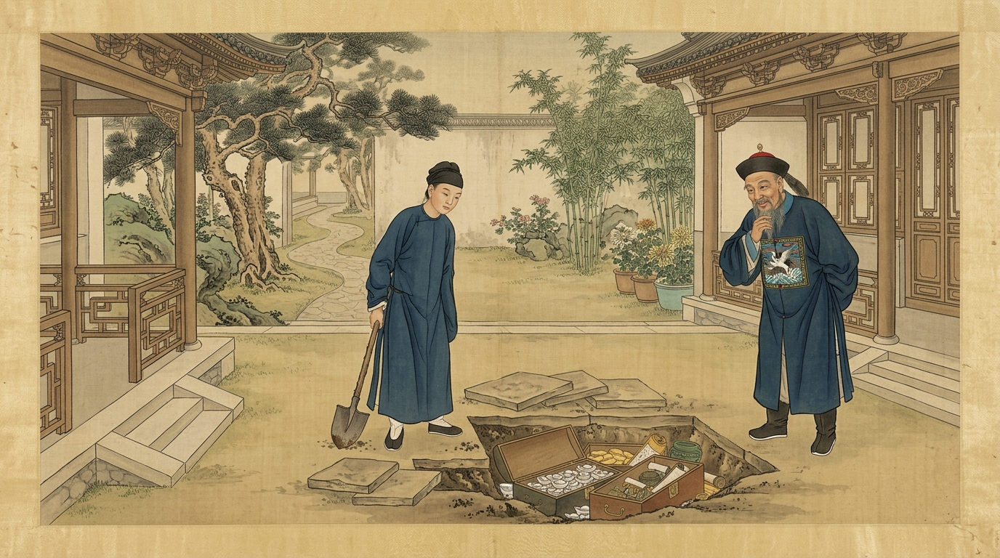
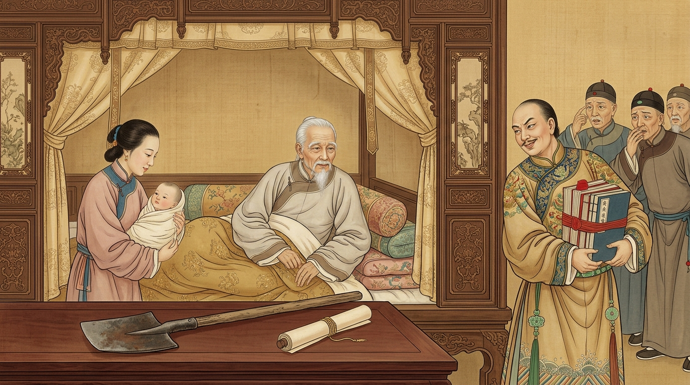
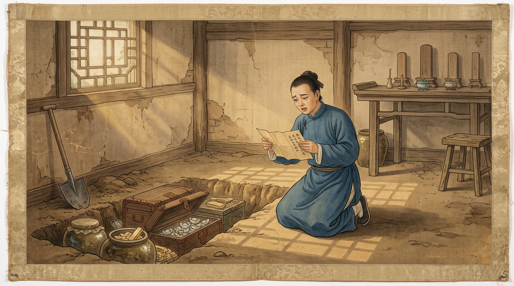

# 富商临终把万贯家财全给女婿，只留幼子一把铁锹：十六年后，全城轰动！
**The Dying Tycoon Left His Entire Fortune to His Son-in-Law, Leaving His Infant Son Only an Iron Shovel: Sixteen Years Later, the Whole City Was Stunned!**

> **【公众号封面图说明】**
> * 配图文件：`./images/shovel_will_wechat_cover.jpg`
> * 画风与规格：传统清代院体绢本设色工笔画，16:9 横幅构图，中心人物聚焦并预留充足安全边距，完美兼容微信公众号封面 **2.35:1（900×383）** 自动裁切区域。
> 
> 

---

> **导读**：“父母之爱子，则为之计深远。”有时候，最深沉的父爱，看起来反而像是一场最残忍的绝情。一位富甲一方的老员外，在临终前写下了一份让全族人唾骂的“荒唐遗嘱”：万贯家业悉数赠予外姓女婿，亲生骨肉却只分得破屋一间、旧铁锹一把。直到十六年后，当那把生锈的铁锹撬开青砖，世人才读懂老人藏在人性深处的生死博弈。
> 
> *Editor's Note: "When parents truly love their child, they plan far ahead for their survival." Sometimes, the deepest paternal love disguises itself as the cruelest indifference. On his deathbed, a wealthy merchant drafted a "ridiculous will" that shocked his entire clan: his vast estate went entirely to his son-in-law, while his own flesh and blood received only a dilapidated cottage and a rusty iron shovel. Only sixteen years later, when that shovel pried open the floor bricks, did the world understand the life-and-death chess game the old man had played against human greed.*

---

## 01. 老来得子的隐忧，与病榻上的“糊涂遗嘱”
**An Old Man's Late Blessing, and a "Foolish Will" on His Deathbed**

江南有一位姓倪的富商，半生经商，攒下了良田千顷、商铺数十间，可谓富甲一方。然而倪员外一生有个最大的遗憾：原配夫人早逝，只留下一个女儿，直到年近七旬，续弦的小妾才终于为他生下了一个白白胖胖的男婴。

老来得子，本是天大的喜事，可还没等满月酒的喜气散去，年迈的倪员外便一病不起，眼看大限将至。

*In the Jiangnan region lived a wealthy merchant surnamed Ni, who had amassed thousands of acres of fertile land and dozens of prosperous shops. Yet for most of his life, Master Ni carried a heavy regret: his late wife had left him only a daughter. Not until he was nearly seventy did his concubine finally bear him a healthy baby boy.*

*Having a son in old age should have been a supreme joy, yet shortly after the baby's first month, the elderly merchant fell gravely ill and knew his days were numbered.*

躺在病榻上的倪员外，看着尚在襁褓中咿呀学语的幼子，非但没有半分笑意，反而愁眉深锁、夜不能寐。

为什么？因为他的大女婿张某，平日里替他打理生意，为人极为精明强悍，且心胸狭隘、贪得无厌。倪员外心里比谁都清楚：**一旦自己咽下这口气，家里孤儿寡母无依无靠；倘若自己把万贯家财留给还在吃奶的幼子，以大女婿的狠毒心肠，不出三年，幼子必定死于非命，家产照样会被女婿吞得一干二净！**

*Lying on his sickbed, gazing at the babbling infant in swaddling clothes, Master Ni could not smile. Instead, his brows were furrowed in sleepless dread.*

*Why? Because his son-in-law, Zhang, who managed the family businesses, was ruthless, calculating, and consumed by greed. Master Ni knew human nature all too well: **Once he closed his eyes, a helpless widow and a nursing infant would stand no chance. If he left his vast fortune to the baby boy, the greedy son-in-law would surely orchestrate an "accident" within three years to seize the inheritance!***

思虑再三，倪员外在临咽气前三天，把族中长辈、大女婿以及抱着幼子的乳母全部叫到了病榻前，颤巍巍地立下了一份让满堂哗然的遗嘱：

> **“吾年迈归西，幼子尚幼，不堪掌业。今将名下良田千顷、商铺大宅，全部交由女婿张氏继承掌管！唯留城南破旧老屋一间、旧铁锹一柄；待幼子年满十六岁成丁之日，将此破屋与铁锹交予他自立门户，两不相欠！”**

*After three nights of silent contemplation, Master Ni summoned the clan elders, his son-in-law, and the wet nurse holding the infant to his bedside. With trembling hands, he announced a will that left the room in stunned disbelief:*

> *"I am old and departing this world, and my infant son is too young to manage our affairs. I hereby bequeath all my thousands of acres, shops, and grand manor to my son-in-law Zhang! Only one rundown cottage in the south of the town and a single old iron shovel shall be set aside; when my son reaches the age of sixteen, give him that cottage and the shovel to make his own way!"*

此言一出，族人无不愕然，纷纷劝说道：“员外三思啊！亲生骨肉怎能分文不留，全便宜了外姓女婿？”

可倪员外却铁了心肠，当众画押盖印。一旁的大女婿原本还暗生毒计，听到这份遗嘱后喜出望外，当场跪地痛哭流涕，拍着胸脯赌咒发誓：“岳父大人放心！小婿一定把小舅子当成亲生骨肉，平平安安抚养成人！”

当晚，倪员外看着满脸得意的大女婿，嘴角闪过一丝无人察觉的微笑，安然闭上了双眼。

*The clan elders gasped in protest: "Master Ni, think twice! How can you leave your own flesh and blood penniless while giving everything to an outsider?"*

*Yet Master Ni remained unmoved, pressing his official seal onto the document. The son-in-law, who had secretly been plotting against the child, was overjoyed. Falling to his knees in tears, he beat his chest and swore: "Rest assured, Father-in-law! I shall raise my little brother-in-law as my own son until he reaches adulthood!"*

*That night, watching his triumphant son-in-law, a faint, imperceptible smile crossed the old man's lips before he peacefully closed his eyes forever.*

---

## 02. 十六载寄人篱下，一柄铁锹扫地出门
**Sixteen Years Under Another's Roof, Cast Out with a Rusty Shovel**

倪员外去世后，大女婿顺利接管了倪家所有的良田与商铺。因为家产已经名正言顺地落入自己口袋，小舅子对他不再构成任何威胁；再加上为了在宗族乡邻面前博一个“仁义守信”的好名声，大女婿果然没有加害幼子，而是管吃管住，任由他在府中平安长大。

转眼间，十六年过去了。昔日襁褓中的婴儿，已长成了一个身高七尺、聪慧沉稳的读书少年。

*After Master Ni's passing, the son-in-law smoothly took over every acre and shop. Because the fortune was already legally his, the baby boy posed zero threat to him. Moreover, to maintain a reputation of righteousness before the townsfolk, the son-in-law kept his word—providing food and shelter so the boy grew up safely.*

*In the blink of an eye, sixteen years passed. The infant in swaddling clothes had grown into a bright, composed young scholar.*

就在少年满十六岁生辰的第二天，大女婿便迫不及待地请来当年见证的族老，当众拿出了那份泛黄的遗嘱、城南破屋的房契，以及那把早已锈迹斑斑的旧铁锹。

大女婿皮笑肉不笑地说道：“好弟弟，如今你已年满十六，姐夫我也算仁至义尽，完成了岳父当年的托付。按照遗嘱，这间老屋和这把铁锹归你，从今日起，你就搬出去自谋生路吧！”

*The very day after the youth turned sixteen, the son-in-law wasted no time. Summoning the clan elders as witnesses, he produced the yellowed will, the deed to the dilapidated southern cottage, and the rusted iron shovel.*

*With a cold, polite smile, the son-in-law said: "Dear brother, you are now sixteen. I have fulfilled my duty to your late father. As written in the will, this old shack and this iron shovel are yours. Pack your things today and go earn your own living with your hands!"*

周围的街坊邻居无不暗自摇头叹息，替这可怜的少年鸣不平：“老员外当年真是老糊涂了！偌大的家业全给了白眼狼，让亲儿子提着把破铁锹去种地！”

少年没有争吵，也没有哭闹。他默默接过那把沉甸甸的旧铁锹与破房契，向着父亲的灵位磕了三个响头，转身独自走向了城南那间荒草丛生的老屋。

*Neighbors shook their heads in pity, murmuring among themselves: "The old master must have lost his mind on his deathbed! Giving a mountain of gold to a cold-hearted son-in-law while leaving his own son to dig dirt with a rusty shovel!"*

*The youth neither argued nor wept. Quietly accepting the heavy old shovel and the worn deed, he kowtowed three times before his father's ancestral tablet, turned around, and walked alone toward the overgrown cottage in the south of town.*

---

## 03. 破屋挥锹撬青砖，一封血书泣鬼神
**Prying Open the Floor Bricks: A Father's Letter Across Time**

推开吱呀作响的破木门，老屋里布满蛛网，只有阳光透过残破的窗棂洒在斑驳的青砖地上。

少年环顾四周，心中也不禁涌起一丝委屈与迷茫：“爹，您一生精明过人，为什么偏偏只留给我一间不能遮雨的破屋，和一把生锈的铁锹？”

*Pushing open the creaking wooden door, the boy found a room thick with cobwebs, where shafts of sunlight pierced through broken lattice windows onto the mottled gray floor bricks.*

*Looking around the empty room, a wave of grievance washed over him: "Father, you were wise all your life. Why did you leave me only a leaky roof and a rusty shovel?"*

他低头端详着手中的铁锹，忽然发现铁锹的木柄末端似乎被蜡封过，敲击之下竟是空心的！

少年心头一震，连忙撬开木柄封蜡，从里面倒出了一卷用油布包裹得严严实实的密信。展开一看，上面赫然是老父亲生前亲笔写下的字迹：

> **“吾儿亲启：父非不爱你，实乃爱你入骨！汝生之时，父命将尽；汝姐夫狼子野心，若父将明面家产分汝一半，汝断无活命之理！故父以千顷浮财为饵，塞其贪欲，借其手护汝十六载周全。今汝已成人，可持此铁锹，掘老屋正堂第十二块青砖，父之真产尽藏于下！”**

*Examining the shovel closely, he suddenly noticed that the base of its wooden handle was sealed with wax—and sounded hollow when tapped!*

*His heart racing, he pried open the wax seal and shook out a tiny scroll wrapped tightly in oiled cloth. Unfolding it, he saw his late father's unmistakable handwriting:*

> *"To my beloved son: It is not that Father did not love you, but that I loved you with my very life! When you were born, my time was nearly up. Your brother-in-law has the heart of a wolf; had I left you half my visible estate, you would never have lived to see adulthood! Thus, I used the lands and shops as bait to satisfy his greed, borrowing his hand to keep you safe for sixteen years. Now that you are a man, take this shovel and dig beneath the twelfth floor brick in the main hall. Your true inheritance awaits below!"*

少年读罢，瞬间泪如雨下，双膝跪倒在地！

他擦干眼泪，握紧那把承载了父亲十六年深情与智谋的铁锹，来到正堂中央，用力撬开了第十二块青砖。随着泥土翻开，下面竟露出了一个巨大的青石地窖——地窖里整整齐齐码放着十几个大陶瓮与铁皮木箱，打开一看，里面全是耀眼夺目的黄金白银与珍贵珠宝，其价值比地面上的田产商铺还要丰厚数倍！

*Reading those words, tears streamed down the youth's face as he fell to his knees!*

*Wiping his eyes, he gripped the shovel that had carried his father's love across sixteen years and pried up the twelfth brick in the center of the hall. Beneath the soil lay a massive stone vault—stacked neatly with over a dozen ceramic jars and iron-bound chests overflowing with gold ingots, silver, and priceless jewels, worth far more than the lands above!*

随后，少年手持父亲的密信来到县衙报备。县令听闻前因后果，捧着那封跨越十六年的遗书击节赞叹，当堂为少年立下官府铁券，确认地窖黄金全归少年所有，任何人不得觊觎。

消息传出，全城轰动！大女婿得知那间自己弃之如敝履的破屋下竟藏着倪家真正的金山，气得当场吐血，却又面对官府文书无可奈何；而少年凭借父亲留下的巨资勤奋苦读、诚信经商，不出数年便重振倪家声威，成为江南一代名士。

*The youth immediately took his father's secret letter to the county magistrate. Deeply moved by the late father's extraordinary foresight, the magistrate issued an official decree guaranteeing the boy's sole ownership of the treasure.*

*When the news broke, the entire city was stunned! Learning that the rundown shack he had so eagerly cast aside held the true mountain of gold, the greedy son-in-law coughed up blood in fury, yet could do nothing against the official seal. With his father's blessing, the young man studied diligently and ran his businesses with integrity, soon restoring the Ni family's prestige across Jiangnan.*

---

## 04. 结语：最高级的智慧，是看透人性后的温柔布局
**Epilogue: The Highest Wisdom Is a Gentle Strategy Built on Knowing Human Nature**

重读这个记载于古籍《折狱龟鉴》与《智囊》中的传奇故事，不禁让人脊背发凉，继而热泪盈眶。

为什么倪员外的一把铁锹，能赢过贪婪狠毒的女婿？因为这位老父亲参透了世间最核心的三条生存铁律：

*Re-reading this classic tale recorded in ancient casebooks leaves one both awestruck and deeply moved.*

*Why did an old man's rusty shovel triumph over a ruthless schemer? Because the father understood three fundamental laws of human survival:*

1. **匹夫无罪，怀璧其罪（Wealth Without Strength Is a Curse）**：
   当一个人的能力还撑不起巨额财富时，财富不是福气，而是催命符。给年幼的孩子留金山，不如先给他留一条能平安长大的命。
2. **最高明的博弈，是顺应人性的弱点（Using Greed to Defeat Greed）**：
   倪员外没有指望女婿“良心发现”，也没有托孤给未必靠得住的族人；而是直接用明面上的家产喂饱女婿的贪欲，让最危险的敌人心甘情愿变成儿子的“保护伞”。
3. **真正的父爱，从不在乎一时的毁誉（True Love Cares Not for Temporary Misunderstanding）**：
   临终背上“老糊涂、偏心眼”的骂名长达十六年，他毫不在意。因为父母之爱，从来不是做给外人看的场面戏，而是护佑儿女一生周全的深谋远虑。

*1. **Wealth Without Strength Invites Disaster:** When a child is too weak to guard a fortune, wealth is not a blessing, but a death sentence.*  
*2. **Masterful Strategy Leverages Human Weakness:** Instead of relying on fragile promises, the father fed his son-in-law's greed to turn the boy's greatest threat into his sixteen-year protector.*  
*3. **Deep Love Endures Misunderstanding:** The old man willingly bore the reputation of a "foolish father" for sixteen years, knowing that true parental love seeks not public praise, but the child's ultimate safety.*

**这世上最顶级的远见，莫过于看透了人心的幽暗与凉薄，却依然能用最巧妙的智慧，为所爱之人劈开一条春暖花开的生路。**

*The highest foresight in this world lies in seeing through the darkest corners of human nature, yet still weaving a path of safety and spring blossoms for those we love.*

---

> 💡 **今日互动话题 / Readers' Corner**  
> 有人感慨老员外“把人性算到了骨子里”，也有人感叹“可怜天下父母心”。读完这个跨越十六年的破屋铁锹局，您最受触动的是哪一点？欢迎在评论区留下您的高见！
