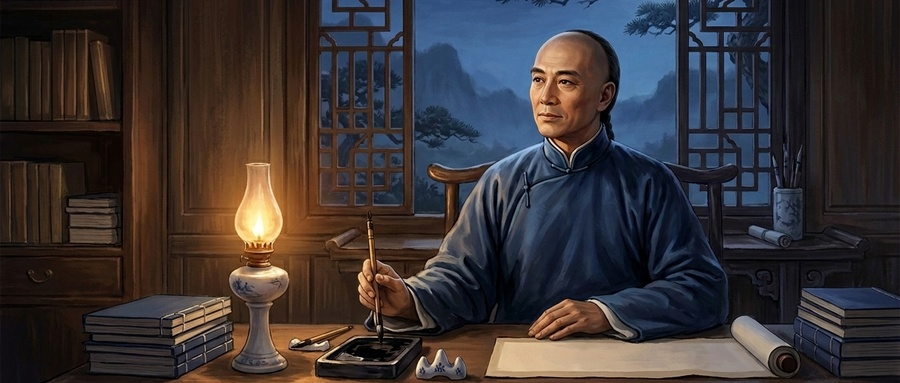
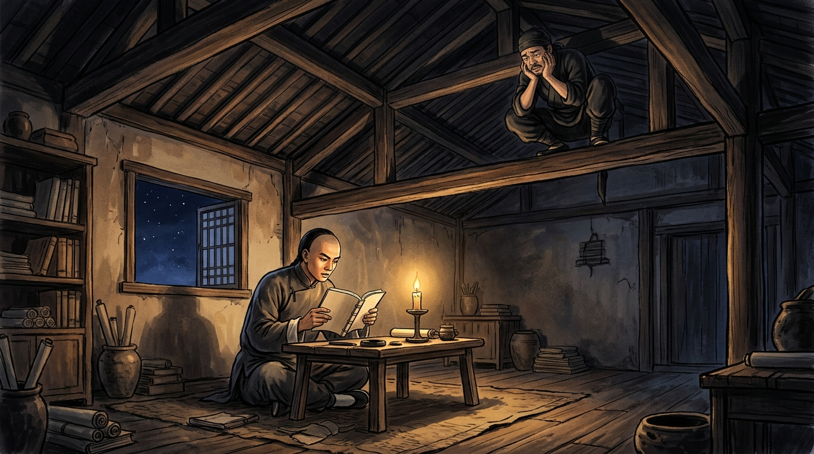

# 晚清第一硬汉曾国藩的“反本能”生存法：为什么越精明的人，越要学会下“笨功夫”？
**The Power of "Clumsy Effort": The Counterintuitive Wisdom of Zeng Guofan in a Fast-Paced World**

> **【公众号封面图说明（2.35:1 官方首条标准） / WeChat Official Cover 2.35:1】**
> * **标准官方封面（900×383）**：`./images/wechat_cover_zeng_guofan_900x383.jpg`
> * **超清高清封面（1800×766）**：`./images/wechat_cover_zeng_guofan_1800x766.jpg`
> * **正文配图一**：`./images/zeng_guofan_thief_in_rafters.jpg`（少年曾国藩夜读与房梁上无奈的小偷）
> * **正文配图二**：`./images/zeng_guofan_solid_camp_steady_battle.jpg`（结硬寨，打呆仗：江防营垒与顶级战略定力）
> 
> 

---

<blockquote style="background-color: #f8fafc; border-left: 5px solid #0f172a; padding: 16px 20px; margin: 22px 0; border-radius: 4px; color: #1e293b; line-height: 1.85;">

【导读 / Editor's Note】

在这个人人都想走捷径、博眼球、搞速成的焦虑时代，“聪明”似乎成了最高赞赏，而“老实下笨功夫”却常被当成笨拙的笑柄。

In an age consumed by shortcuts, instant gratification, and relentless anxiety, "cleverness" is often praised as the ultimate virtue, while "honest, clumsy effort" is ridiculed as mere sluggishness.

然而，翻开晚清历史，被后世公认为“立德、立功、立言三不朽”的晚清第一完人曾国藩，却偏偏是历史上出了名的“笨人”。

Yet turn the pages of late Qing dynasty history, and you will find Zeng Guofan—widely hailed as the rare statesman achieving immortality in virtue, achievement, and words—was paradoxically renowned as a self-confessed "clumsy man."

他考秀才考了7次才中，背书慢到连房梁上的小偷都忍不住跳下来嘲笑他；可他一生打仗却靠“结硬寨，打呆仗”平定大乱，做事信奉“天下之至拙，能胜天下之至巧”。

He failed the imperial entry exams six times before scraping through on his seventh attempt, and was once mocked by a thief in his own rafters for repeating a text all night without memorizing it. Yet he commanded armies with the motto "build solid camps and fight steady battles," firmly believing that "supreme clumsiness overcomes supreme cunning."

今天，让我们从这位“笨汉”波澜壮阔的一生中，读懂那份穿越百年的顶级处世智慧。

Today, let us explore the extraordinary life of this stubborn man and discover the timeless power of counterintuitive wisdom in a fast-paced world.

</blockquote>

---

<h2 style="color: #92400e; border-left: 6px solid #d97706; padding-left: 12px; margin: 32px 0 6px 0; font-size: 19px; line-height: 1.4;">01. 房梁上的小偷与考秀才七次：一个资质平平的“笨小孩”</h2>

The Thief in the Rafters: The Boy Who Failed Seven Times

道光年间的一个深夜，湖南湘乡荷叶塘的一间普通农舍里，油灯如豆。

On a late winter night during the Daoguang era, inside a humble farmhouse in Hunan, a tiny oil lamp flickered weakly.

少年曾国藩正坐在书桌前，死磕一篇并不算长的高头讲章。他一遍又一遍地大声诵读，读了三五十遍，依然磕磕绊绊，背不下来。

Young Zeng Guofan sat at his wooden desk, grappling with a short classical essay. He read it aloud dozens of times, yet still stumbled and failed to commit it to memory.

但他极其固执，秉承着父亲立下的规矩：<strong>背不下这一篇，决不睡觉；读不懂这一段，决不看下一段。</strong>

Yet he possessed an obstinate determination, adhering strictly to his father's family rule: <strong>never sleep until the passage is mastered, and never turn the page until the current line is fully understood.</strong>

殊不知，此时屋顶的房梁上正蜷缩着一个潜入的小偷。小偷本打算等书生熄灯就寝后下手偷盗，结果趴在冰冷的梁上冻得瑟瑟发抖，硬生生听这个书生把一篇文章念了近百遍。

Unbeknownst to him, a burglar was crouched among the freezing ceiling rafters. Waiting for the student to blow out the lamp so he could steal, the thief shivered in the drafty dark, forced to listen to the boy recite the exact same text nearly a hundred times.

图1：少年曾国藩夜读与房梁上的无奈小偷 / Fig 1: Young Zeng Guofan's Midnight Study & The Exasperated Thief

到了后半夜，小偷实在忍无可忍，愤怒战胜了做贼的心虚。他纵身从梁上一跃而下，指着曾国藩的鼻子大骂：

Deep into the witching hour, the thief could bear it no longer. His sheer exasperation overcame his fear of being caught. Leaping down from the beam, he pointed angrily at Zeng's nose and shouted:

<blockquote style="background-color: #fffbeb; border-left: 4px solid #f59e0b; padding: 12px 18px; margin: 16px 0; color: #92400e; line-height: 1.75;">
<strong>“就凭你这种榆木脑袋，还妄想考取功名？听我都听会了！”</strong> 
"With a wooden head like yours, how dare you dream of passing the imperial exams? Even I have memorized it just by listening!"
</blockquote>

说完，小偷当场将那篇文章一字不漏、抑扬顿挫地背诵了一遍，随后冷笑一声，大摇大摆地翻墙而去。

With that, the thief recited the entire classical passage fluently from beginning to end without missing a single syllable, sneered at the dumbfounded scholar, and strode out into the night.

如果换作一般人，自尊心早已被当场击得粉碎。但曾国藩没有羞愧自弃，也没有怨天尤人，而是平静地整理好衣冠，重新拿起书本继续苦读——<strong>既然别人一遍能懂，我读百遍；别人一日能精，我做十年。</strong>

For most people, such humiliation would shatter their self-esteem forever. But Zeng Guofan neither surrendered to despair nor blamed fate. He quietly straightened his robes, picked up his book, and resumed reading: <strong>if others master a text in one attempt, I will read it a hundred times; if others achieve brilliance in a day, I will dedicate ten patient years.</strong>

他的笨拙不仅体现在背书上。在最基础的童试考秀才中，同时代的神童左宗棠14岁一考即中，李鸿章也是少年科名；唯独曾国藩，从14岁考到23岁，<strong>整整连考了 6 次，全部惨痛落榜</strong>！

His clumsiness went far beyond slow memorization. While contemporary prodigies like Zuo Zongtang and Li Hongzhang passed the exams with effortless brilliance in their teens, Zeng Guofan sat for the entry-level examinations six times from age 14 to 23—<strong>failing consecutively each time</strong>.

在第六次落榜时，湖南学政甚至将他的试卷公开展出，作为文理欠通、行文呆板的“反面教材”公开批评。然而正是面对这种奇耻大辱，他在第7次考试中咬碎牙关，终于考取了一个排在末尾的秀才。

After his sixth failure, the provincial education examiner even pinned up his paper as a public negative example of rigid, clumsy prose. Yet weathering this bitter public reprimand, he persevered and finally passed on his seventh try, scraping into the ranks as a humble local scholar.

---

<h2 style="color: #1e40af; border-left: 6px solid #2563eb; padding-left: 12px; margin: 32px 0 6px 0; font-size: 19px; line-height: 1.4;">02. 读书与修身：一句不通，绝不看下一句</h2>

A Single Sentence at a Time: The Iron Discipline of Deep Mastery

资质平平的曾国藩，后来为何能成为晚清学术造诣极高的一代通儒？秘诀就在于他的<strong>“笨拙死磕法”</strong>。

How did an ordinary mind like Zeng Guofan ultimately become one of the most revered Confucian scholars of the late Qing dynasty? The secret lay entirely in his <strong>relentless, stubborn thoroughness</strong>.

曾国藩给自己定下了一条近乎自虐的读书规矩：

He established an uncompromising, near-ascetic rule for his intellectual development:

<strong>“一句不通，不看下句；今日不通，明日再读；今年不通，明年再读。”</strong> 
"If one sentence is not thoroughly understood, never proceed to the next; if it remains unclear today, study it tomorrow; if it eludes you this year, wrestle with it the next."

反观今天的许多人，追求速读、速成、提炼干货，一年看似读了一百本书，实际上浮光掠影，连核心逻辑都理不清楚。而曾国藩读一本书，往往慢得让人着急，但只要被他读过一遍，书中的义理、辞章、结构就如刻在骨髓里一样，终身受用。

By contrast, many in modern times chase speed-reading, summaries, and instant knowledge nuggets. They boast of finishing a hundred books a year, yet retain only superficial fragments. Zeng read agonizingly slowly, but once he digested a volume, its principles and logic were etched permanently into his marrow for a lifetime.

三十岁那年，他在北京翰林院供职，深感自己心浮气躁、脾气暴躁，立誓洗心革面，做内圣外王之君子。从那天起，他开始用小楷毛笔坚持写日记，进行每日极其残酷的自我解剖：

At age thirty, while serving in the Hanlin Academy in Beijing, he realized his temperament was prone to arrogance and impatience. Vowing to reinvent himself into a true sage, he began keeping a daily diary in meticulous regular brush calligraphy, conducting ruthless self-examination every evening:

  
<strong>• 戒多言 (Restraining Idle Chatter):</strong> 在朋友聚会上夸夸其谈、出言刻薄，回家就在日记里痛骂自己“言不由衷，轻薄可鄙”；

  
If he boasted or spoke sarcastically at a gathering, he would severely reproach himself in his journal that night as "hollow, flippant, and contemptible";

  
<strong>• 戒妄念 (Disciplining Wandering Thoughts):</strong> 席间忍不住多看了朋友的美姬一眼，回家便在日记里狠狠批责自己“目挑心招，何其无耻”；

  
If his eyes lingered on a beautiful woman at a banquet, he scathingly recorded his shame: "Allowing untamed lust to stir within—what disgrace!";

  
<strong>• 戒怠惰 (Conquering Sloth):</strong> 早上偶有赖床或读书分神，必在日记里重罚自己静坐读经。

  
If he overslept or allowed his mind to drift from morning study, he disciplined himself with hours of meditative reading.

这套笨拙至极的自省日记，他整整坚持了三十年，直到临终前一天未曾间断！

This clumsy, unsparing discipline of daily diary introspection was maintained unbroken for thirty consecutive years, right up until the day before his death.

正如他后来在家书中所写：“<strong>天下之至拙，能胜天下之至巧。</strong>”真正拉开人与人之间差距的，从来不是先天的灵光乍现，而是后天十年如一日的“笨拙磨砺”。

As he later instructed his family: "<strong>Supreme clumsiness overcomes supreme cunning.</strong>" What truly separates the extraordinary from the mediocre is never sporadic flashes of genius, but the relentless, day-in-day-out grinding of raw character over decades.

---

<h2 style="color: #047857; border-left: 6px solid #10b981; padding-left: 12px; margin: 32px 0 6px 0; font-size: 19px; line-height: 1.4;">03. 军事奇迹：“结硬寨，打呆仗”背后的顶级战略定力</h2>

Building Solid Camps, Fighting Steady Battles: Victory Through Immovability

咸丰三年，太平天国起义如狂风暴雨般横扫江南半壁，大清王朝百战不殆的八旗军与绿营兵望风溃散。

In 1853, the Taiping Rebellion swept across southern China like an apocalyptic storm. The Qing dynasty's official Eight Banners and Green Standard Armies collapsed in total disarray.

一个从未带过兵的文弱书生曾国藩，在湖南奉旨编练乡勇。面对战力极其凶悍、行踪诡秘如风的太平军悍将，朝野内外都在谋求所谓的“奇谋妙策、出奇制胜”。

Zeng Guofan, a frail civil scholar who had never commanded a single soldier, was ordered to organize local militia in Hunan. Facing fierce, highly mobile Taiping commanders, conventional generals frantically sought dazzling maneuvers and surprise ambushes.

然而曾国藩却拿出了六个让所有军事行家大跌眼镜的字：<strong>“结硬寨，打呆仗。”</strong>

Yet Zeng proposed a tactical doctrine that initially bewildered military theorists across China: <strong>"Build solid camps, fight steady battles."</strong>

图2：结硬寨打呆仗：湘军沿江营垒与坚韧的防御定力 / Fig 2: Solid Camps & Steady Battles: The Immovable Defensive Power of the Xiang Army

什么叫“结硬寨”？

What did it mean to "build solid camps"?

湘军每行军到一个新驻地，无论官兵多么疲惫饥饿，第一件事绝不是安营休整，而是立刻全员拿起铁锹锄头挖土砍木。他们必须在几个时辰内，挖出宽一丈、深一丈的环形壕沟，筑起一人多高的结实木栅土墙，硬生生在野外凭空造出一座坚固城堡！

Wherever the Xiang Army marched, no matter how exhausted the soldiers were, their very first priority was never to rest, but to pick up spades and axes. Within hours, they dug continuous moats ten feet wide and ten feet deep, reinforced by heavy timber palisades, creating an impenetrable fortress in open wilderness.

什么叫“打呆仗”？

And what did it mean to "fight steady battles"?

曾国藩打仗从不跟敌人野战拼速度、赌运气，而是“反客为主”——我把坚不可摧的硬寨推到你的城门脚下，用长壕深堑将你层层锁死。敌人急了来冲营，他在高墙深壕后居高临下射杀；敌人若闭门不出，他便以日计算切断粮道，直到城中弹尽粮绝。

Zeng never gambled on reckless open-field clashes. Instead, he systematically advanced his fortified camps right up to the enemy's walls, entrenching them within concentric moats. When desperate enemies charged his fortifications, they were cut down from safety; when they refused to battle, he severed their supply lines until their reserves ran completely dry.

<strong style="color: #064e3b; font-size: 15px;">【高手的底层思维：先求不可胜，以待敌之可胜】</strong> 

曾国藩深知自己不是用兵如神的韩信白起，所以他把全部精力放在了<strong>“确保自己绝不犯错”</strong>上。

Knowing he was no military genius of mythological lore, Zeng focused entirely on <strong>making himself completely invulnerable to error</strong>.

只要自己立于不败之地，不给对手留一丝破绽，对手迟早会在焦躁中露出致命破绽！

By making himself utterly unshakeable, time became his greatest ally—the opponent would inevitably crumble under their own impatience.

---

<h2 style="color: #7c2d12; border-left: 6px solid #ea580c; padding-left: 12px; margin: 32px 0 6px 0; font-size: 19px; line-height: 1.4;">04. 处世反本能：为什么越聪明的人，越容易死在“自作聪明”上？</h2>

The Trap of Over-Cleverness: Why Quick Wits Often Lead to Ruin

曾国藩晚年阅人无数，他在写给弟弟与儿子的家书中，留下了这样一句振聋发聩的名言：

Having evaluated thousands of individuals across his lifetime, Zeng left a piercing warning in his family letters:

<blockquote style="background-color: #fff7ed; border-left: 4px solid #ea580c; padding: 12px 18px; margin: 16px 0; color: #9a3412; line-height: 1.75;">
<strong>“天下古今之才人，皆以一傲字致败；天下古今之庸人，皆以一惰字致败。”</strong> 
"Throughout history, talented men fail on account of arrogance; while ordinary men fail on account of indolence."
</blockquote>

现实生活中，很多看似精明聪明的人，总在寻找投入产出比最高的“捷径”：

In modern life, countless clever individuals exhaust themselves hunting for low-effort, high-yield shortcuts:

  
<strong>• 盲目追逐风口 (Chasing Trends):</strong> 哪个行业赚钱就涌向哪个行业，一旦遇到困难就立刻弃船跳槽，看似四面玲珑，实则半桶水晃荡；

  
They jump from trend to trend, abandoning ship at the first sign of headwinds, appearing versatile while never cultivating true depth;

  
<strong>• 鄙视基础重复 (Disdaining Repetition):</strong> 嫌弃日复一日的基础积累枯燥乏味，总幻想有一夜暴富、一战成名的“神仙秘籍”。

  
They disdain mundane daily repetitions as tedious and unglamorous, fantasizing about an overnight miracle to skip the hard climbing.

而真正的顶级高手，全都深谙<strong>“反本能”</strong>的法则：

Yet masters of enduring success understand the power of living against instinctive impulses:

人性的本能是趋利避害、好逸恶劳、急功近利；而所谓的“笨功夫”，就是<strong>克制住对速成的渴望，把一件事做到极致，把一个领域做穿做透</strong>。

Human instinct craves effortless ease and instant results. "Clumsy effort" means <strong>overriding the thirst for quick fixes, mastering fundamentals to absolute perfection, and penetrating a single domain until water turns to rock</strong>.

---

<h2 style="color: #6b21a8; border-left: 6px solid #9333ea; padding-left: 12px; margin: 32px 0 6px 0; font-size: 19px; line-height: 1.4;">05. 结语：在快时代里，做一条深沉奔涌的静水深流</h2>

Conclusion: Flowing Deep and Quiet in a Restless World

从那个被房梁上小偷无情嘲笑的笨拙少年，到成为挽狂澜于既倒的晚清中兴领袖；曾国藩用一生的轨迹，给所有资质平平的普通人指明了一条终极道路：

From the humiliated boy mocked by a thief in his own ceiling, to the pillar of statecraft steering a turbulent empire, Zeng Guofan illuminated a profound path for every ordinary soul:

不聪明不可怕，可怕的是在纷扰浮躁的世界里，丧失了踏实下笨功夫的定力。

Lacking brilliance is no curse; the true tragedy is losing the steady discipline to grind through clumsy effort in a restless, distracted world.

世界上最快的捷径，往往是那个看起来最笨、最慢的办法。因为每一步都踩在坚实的泥土里，没有一步是虚浮的，所以永远不会倒退。

The fastest shortcut on Earth is often the one that looks slowest and most clumsy. Because every step lands solidly upon bedrock, not a single inch is wasted on illusions, and one never retreats.

在喧嚣的时代里，愿你也能耐得住寂寞，守得住拙朴，做一条不声不响、深沉奔涌的静水深流。

Amidst the noisy clamor of today, may you endure solitude, cherish steadfast clumsiness, and become a deep, silent river flowing inexorably toward greatness.

  
“人皆趋巧，我独守拙；凡事做在极钝处，功夫方显极灵时。”

  
"While others chase fleeting cleverness, I anchor my soul in patient clumsiness; only when effort is applied at the dullest root will true mastery reveal its luminous grace."

