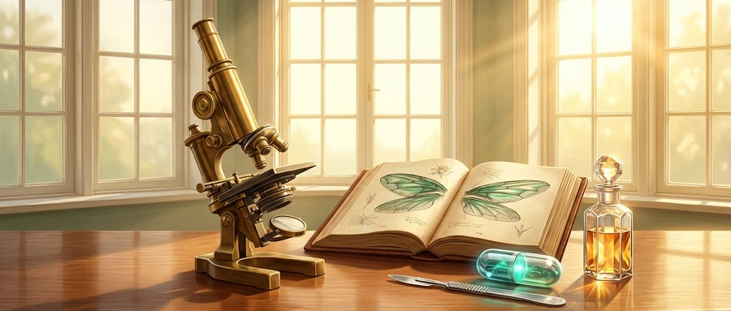
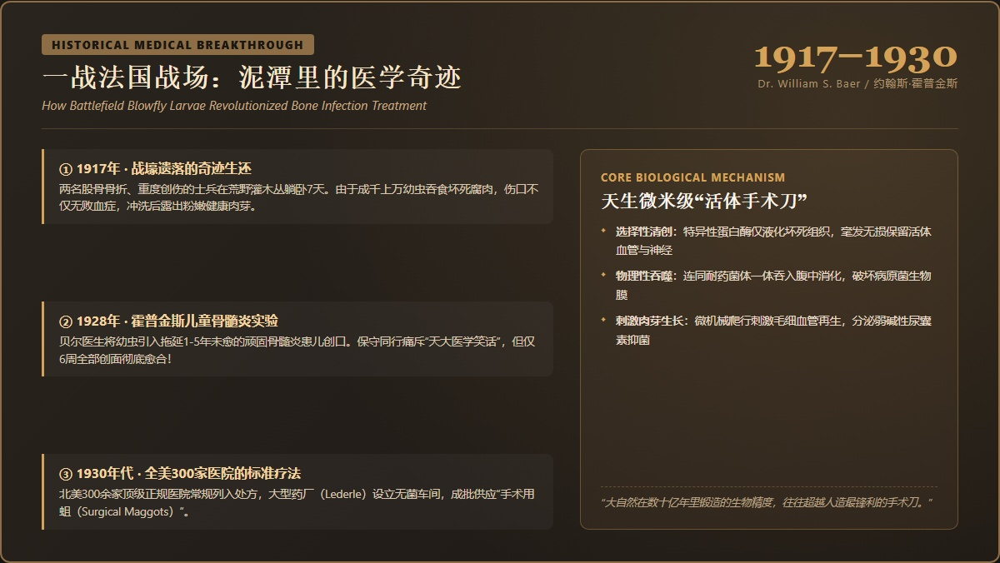

# 真实的历史比你想象的更离谱！被嫌弃的“蛆虫”，如何成为拯救无数人的“活体手术刀”？
**Stranger Than Fiction: How the Most Despised Creature Became Modern Medicine's "Living Scalpel"**

> **【公众号封面图说明（2.35:1 官方首条标准）】**
> * **标准官方封面（900×383）**：`./images/wechat_cover_medical_maggots_900x383.jpg`（严格按微信公众号首条 2.35:1 比例裁切，居中聚焦，安全留白）
> * **超清高清封面（1800×766）**：`./images/wechat_cover_medical_maggots_1800x766.jpg`（2倍超清高分屏适配）
> * **正文配图一**：`./images/medical_history_ww1_field_hospital.jpg`（1917年一战野战医院的历史医学奇迹）
> * **正文配图二**：`./images/modern_medical_maggot_therapy.jpg`（现代无菌生物清创疗法对抗超级细菌）
> 
> 

---

<blockquote style="background-color: #f0fdf4; border-left: 5px solid #16a34a; padding: 14px 18px; margin: 20px 0; border-radius: 4px; color: #1e293b; line-height: 1.75;">
<strong>导读</strong>：在几乎所有人的日常认知里，“蛆”是肮脏、腐烂与恶心的代名词。然而，真实的历史往往比编剧的脑洞还要离谱一百倍：<strong>正是这种被全人类嫌弃的微小生物，在百年前的一战战壕里创造了医学奇迹；它曾被全美300多家医院推上神坛，随后被抗生素扫地出门；却又在“超级细菌”肆虐的今天，被美国FDA正式认证为合法的“高级医疗器械”！</strong>今天，让我们一起走进这段充满震撼与反转的医学冷历史。  
<em style="color: #64748b; font-size: 14px;">Editor's Note: To almost everyone, maggots represent decay, filth, and revulsion. Yet real history is far stranger than fiction: <strong>this despised creature performed miracles in WWI trenches, was embraced by over 300 North American hospitals, got abandoned after the rise of penicillin, and has now staged a triumphant comeback as an FDA-cleared "living medical device" against deadly superbugs!</strong> Today, let's explore this astonishing chapter of medical history.</em>
</blockquote>

---

<h2 style="color: #1e40af; border-left: 6px solid #2563eb; padding-left: 12px; margin: 32px 0 10px 0; font-size: 19px; line-height: 1.4;">01. 1917年一战泥潭：两个躺了7天的士兵与“成千上万条虫子”</h2>

The 1917 Battlefield Miracle: Two Forgotten Soldiers and Thousands of Maggots

1917年，第一次世界大战激战正酣，法国战场沦为泥泞与血火的绞肉机。

在一次搜救中，医护兵在荒野灌木丛深处，意外发现了两名被遗漏的重伤士兵。他们的大腿骨被炮弹炸得粉碎，腹部全是被弹片撕裂的狰狞伤口。在没有水、没有食物的露天战壕里，他们已经整整**熬过了 7 个昼夜**。

在那个连青霉素都尚未发明的年代，这种重度开放性创伤几乎等于宣判死刑——**十个伤兵里，往往有七八个会在48小时内死于严重感染、高烧与败血症**。

可当这两名士兵被抬进野战医院时，当值的外科军医**威廉·贝尔（Dr. William S. Baer，约翰斯·霍普金斯大学骨科名医）**惊呆了：**两个士兵不仅神志清醒，体温更是完全正常，丝毫没有败血症的迹象！**

医生迅速剪开他们早已被血污浸透发硬的军装，眼前的景象让在场所有护士失声倒吸凉气：

> **两个人的伤口深处，密密麻麻、蠕动着成千上万条白色的苍蝇幼虫（蛆）！**

强忍着生理不适，医生用消毒生理盐水冲洗创口。当厚厚的虫群被冲刷干净后，奇迹出现了：

伤口里**没有一滴令人作呕的黄绿脓液**，更没有恶臭扑鼻的腐肉；暴露在眼前的，竟然是**一片片干干净净、泛着粉红色光泽的鲜嫩肉芽组织！**

贝尔医生在那一刻顿悟了自然界的惊天秘密：
> **这类特定的苍蝇幼虫（丝光绿蝇幼虫），拥有世界上最精密的天赋本能——它们只吃死肉、坏肉与腐烂组织，对健康的好肉和血管绝不触碰！**

*In 1917, Dr. William S. Baer treated two soldiers left unattended for seven days in no-man's land with shattered femurs and abdominal wounds. Instead of succumbing to lethal sepsis, their wounds were teeming with thousands of blowfly larvae. Once washed, the wounds revealed no pus, no necrotic tissue—only clean, healthy, pink granulation flesh.*

---

<h2 style="color: #b45309; border-left: 6px solid #f59e0b; padding-left: 12px; margin: 32px 0 10px 0; font-size: 19px; line-height: 1.4;">02. 孤勇者的临床实验：从“医学笑柄”到300家医院争抢的“手术蛆”</h2>

From Medical Laughingstock to Standard Care in 300 Hospitals

战争结束后，贝尔医生回到了美国约翰斯·霍普金斯大学医学院。那震撼的一幕始终在他脑海里挥之不去。

当时医学界有一道极其顽固的绝症——**慢性骨髓炎（Chronic Osteomyelitis）**。细菌深深钻入骨髓内部，造成骨质坏死、经年累月流脓溃烂。许多患病的孩子历经了三四次开骨刮脓手术，忍受了一到五年的折磨，依然无法痊愈，最终只能被迫截肢或衰竭而亡。

1928年，贝尔医生做出了一个在当时被同行视为“离经叛道”的疯狂决定：
**他将人工无菌培育的苍蝇幼虫，放进了几个患骨髓炎孩子的伤口深处。**

消息传出，整个医学界炸开了锅。保守的同行们公开嘲讽他搞的是**“天大的医学笑话”**，甚至指责他是在拿活人进行不道德的巫术实验。

然而，冷酷的数据与事实狠狠回击了所有偏见：

<strong style="color: #854d0e;">【1928-1930年 贝尔医生的临床战报】</strong> 
经治慢性骨髓炎重症患儿： 21 例 
平均病程： 拖延 1 至 5 年未愈，多次手术失败 
幼虫生物清创疗法结果： 仅需 6 至 7 周，全部 21 例伤口彻底愈合，健康出院！

原来，这群小生物在伤口里完成了人类外科医生根本做不到的三重奇迹：
1. **机械与酶解双重清创**：幼虫分泌特异性蛋白溶解酶，只液化坏死组织，毫发无损地保留健康的毛细血管与神经；
2. **生物杀菌中和**：它们在吞食腐肉的同时，将细菌一并吞入腹中消化杀灭，并分泌弱碱性的尿囊素（Allantoin），创造不利于细菌繁殖的环境；
3. **加速肉芽生长**：幼虫在创面的微小蠕动形成了持续的微机械刺激，促进了新鲜肉芽的急速增生。

随后，奇迹迅速席卷北美。到了1930年代末，**美国和加拿大超过300家大型正规医院都在常态化使用该疗法**。大型制药公司（如莱德利实验室 Lederle）甚至开辟了专门的无菌车间，大批量装罐出售标准化的**“手术用蛆（Surgical Maggots）”**！

---

<h2 style="color: #9a3412; border-left: 6px solid #ea580c; padding-left: 12px; margin: 32px 0 10px 0; font-size: 19px; line-height: 1.4;">03. 抗生素的黄金时代：“活体清创者”被扫进历史垃圾堆</h2>

The Penicillin Revolution: Why the Maggots Were Fired

然而，辉煌并没能持续太久。

1940年代，随着弗莱明发现的**青霉素（Penicillin）**实现工业化大批量生产，人类医药史正式迈入了波澜壮阔的“抗生素时代”。

在洁白高效的药片与冰凉晶莹的针剂面前，古老的生物疗法显得如此原始而尴尬：
* **体验对比**：轻轻打一针青霉素就能杀菌，既干净又体面；谁还愿意在清醒状态下，看着自己的伤口里塞满蠕动的活体昆虫？
* **管理成本**：幼虫有其生物生命周期，必须低温冷链保存且无法长久存放；而西药针剂不仅保质期长，运输使用也极其方便。

几乎在短短几年内，全国各大医院的“生物清创箱”被彻底撤下。**曾经拯救无数伤员的“手术蛆”，被无情地贴上了“落后野蛮”的标签，直接丢进了历史的故纸堆中。**

大自然在现代合成化工的巨浪面前，似乎彻底败下了阵来。

---

<h2 style="color: #047857; border-left: 6px solid #10b981; padding-left: 12px; margin: 32px 0 10px 0; font-size: 19px; line-height: 1.4;">04. 超级细菌的复仇：现代医学重新向大自然低头</h2>

The Return of the Superbugs: Why High-Tech Medicine Re-Embraced Nature

人类的高傲，很快迎来了细菌的残酷反扑。

半个多世纪以来，抗生素在全球范围内的无节制滥用，以惊人的速度催生出了一批批刀枪不入的“终极变异体”——**耐甲氧西林金黄色葡萄球菌（MRSA）、泛耐药铜绿假单胞菌等超级细菌（Superbugs）**。

面对这些连最强抗生素（如万古霉素）都束手无策的耐药菌株，现代医生重新陷入了恐慌。特别是在**糖尿病足溃烂（Diabetic Foot Ulcers）**和重度压疮（褥疮）患者身上：
* 伤口深处的微循环严重受阻，口服或静脉注射的抗生素根本无法通过坏死血管抵达感染核心；
* 外科医生用手术刀刮肉，极其容易伤及原本脆弱的健康组织，甚至导致创面大出血、二次感染，数十万患者最终只能面临截肢保命的悲惨命运。

危急关头，医学家们猛然想起了那个被尘封了半个世纪的“古老武器”。

**因为蛆虫吃烂肉，靠的从来不是化学药物阻断，而是物理吞噬与生物酶解！**
* 哪怕细菌把抗药性练到天下第一，但在饥肠辘辘的幼虫面前，它依然只是一口可口的蛋白质点心；
* 蛆虫所到之处，坏死发黑的死肉被精准剥离吞食，细菌生物膜（Biofilm）被瓦解殆尽，而健康的神经和肉芽却被完好无损地庇护下来。

现代生物技术更为这项古老疗法插上了科技的翅膀：
现在的医院不再是直接把虫子倒在伤口上，而是将数万条经过严苛辐射灭菌的幼虫，封装在**透气、透液但虫子钻不出来的特制“生物茶包（Biobag）”**内。敷在伤口上48至72小时，茶包就能悄无声息地将所有烂肉清理得干干净净，患者甚至几乎感觉不到异样。

<strong style="color: #064e3b; font-size: 15px;">【FDA 官方权威认证的华丽回归】</strong> 
<strong>2004 年 1 月</strong>：美国食品药品监督管理局（FDA）正式通过 510(k) 审批，<strong>将医用蛆虫（Medical Maggots）正式列为合法上市销售的处方医疗器械（Medical Device）</strong>！ 
这比我们熟知的“医用水蛭（Leech）”获得官方批准，还要早整整半年时间！

---

<h2 style="color: #7c3aed; border-left: 6px solid #8b5cf6; padding-left: 12px; margin: 32px 0 10px 0; font-size: 19px; line-height: 1.4;">05. 结语：大自然的谦卑启示录</h2>

Conclusion: The Humble Wisdom of Evolutionary Biology

从一战阴湿战壕里的意外发现，到三四十年代的万人推崇；从抗生素时代的弃之如敝履，再到今天面对超级细菌时的王者归来……

这只小小白虫的百年命运流转，是整个现代医学史的一面生动镜子。

它不仅给身患绝症、面临截肢的糖尿病患者带来了重新站立行走的希望，更在人类傲慢的科技神殿里敲响了一记警钟：

**大自然历经数十亿年演化淬炼出的生物智慧，往往比人类实验室里最复杂的化学方程式更为精妙绝伦。**

有时候，我们以为的“落后”与“丑陋”，不过是人类在认知局限下的偏见；而最高级的科学态度，永远是对这颗星球上每一个微小生命，心怀敬畏与谦卑。

“在科学探索的旷野上，治愈的力量往往不来自精密的机械，而藏在最微末的造物之中。”

*In the boundless realm of scientific discovery, healing power rarely belongs to machinery alone—it often dwells in the humblest creations of the living world.*
